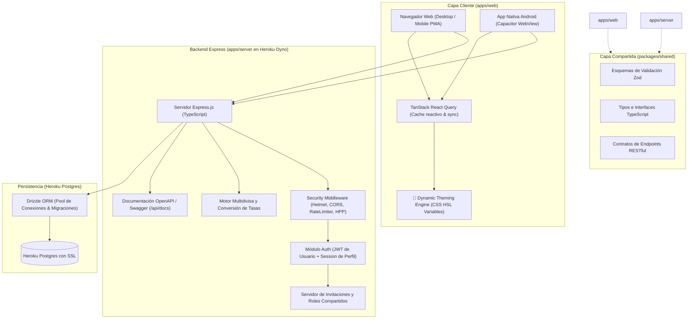
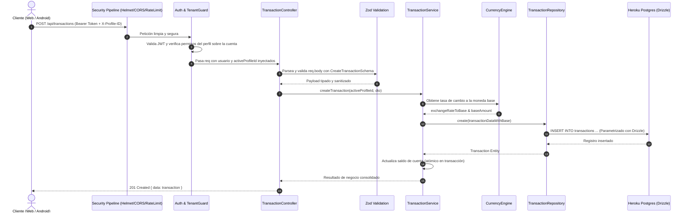

# 03. Arquitectura del Sistema: Koin (Monorepo Turborepo + Heroku)

## 1. Visión General de la Arquitectura

Koin está diseñado bajo una arquitectura de **Monorepo con Turborepo**, dividida en servicios y paquetes compartidos con tipado estricto de extremo a extremo, desplegable en **Heroku** sobre un dyno Node.js unificado y conectado a **Heroku Postgres**.



---

## 2. Jerarquía de Autenticación, Perfiles y Colaboración (Estilo Streaming)

El modelo de acceso resuelve la necesidad de cuentas centrales e invitaciones entre perfiles:

```mermaid
graph TD
    UserAdmin["Usuario Cuenta (Email & Password / Admin)"] --> Profile1["Perfil 1: Dylan (Personal)"]
    UserAdmin --> Profile2["Perfil 2: Casa / Hogar (Familiar)"]
    UserAdmin --> Profile3["Perfil 3: Freelance (Negocio)"]

    OtherUser["Otro Usuario Registrado (Email B)"] --> ProfileB["Perfil: María"]

    Profile1 --> PrivAcc1["Cuenta Privada: Billetera Efectivo"]
    Profile1 --> PrivAcc2["Cuenta Privada: Tarjeta Visa"]

    SharedAcc["💰 Cuenta Compartida: Gastos Comunes Hogar"]
    Profile2 -->|Propietario / Admin| SharedAcc
    ProfileB -->|Perfil Invitado (Editor)| SharedAcc
```

### 2.1 Niveles de Acceso
1. **Cuenta de Usuario (`User`)**:
   - Registro mediante Email y Contraseña (con opción Sign-In / Sign-Up).
   - Actúa como la cuenta administradora o titular del espacio.
   - Emite un JWT seguro de usuario.
2. **Perfiles (`Profile`)**:
   - Una cuenta puede tener múltiples perfiles (ej. Dylan, María, Finanzas Hogar, Negocio).
   - Cada perfil tiene su nombre, avatar, tema visual independiente (colores configurables), moneda base y **PIN de seguridad opcional**.
   - Conmutación rápida entre perfiles sin cerrar la sesión de la cuenta principal.
3. **Cuentas Financieras Privadas vs Compartidas**:
   - **Privadas**: Visibles y operables únicamente por el perfil que las creó.
   - **Compartidas**: Cuentas donde el perfil propietario puede **invitar a otros perfiles** (de su misma cuenta o perfiles de otros usuarios por email/enlace) asignándoles roles:
     - `owner`: Control total, agregar/remover miembros, eliminar cuenta.
     - `editor`: Registrar gastos e ingresos, ver transacciones y presupuestos.
     - `viewer`: Solo lectura para consultar saldos y reportes.

---

## 3. Motor Multidivisa y Conversión de Tasas

1. **Moneda Base por Perfil**:
   - Cada perfil define su moneda principal de consolidación (ej. USD, EUR, COP, MXN).
2. **Cuentas en Diferentes Divisas**:
   - Una cuenta puede estar en USD (ej. Cuenta extranjera/Paypal), otra en EUR y otra en moneda local (ej. COP).
3. **Manejo de Transacciones**:
   - Toda transacción guarda el monto original, la divisa de origen y la tasa de cambio a la moneda base en la fecha del registro (`exchangeRateToBase`).
   - El sistema calcula el equivalente en moneda base para presentar reportes consolidados sin distorsión.
4. **Tabla de Tasas (`exchange_rates`)**:
   - Módulo que almacena tasas de cambio diarias con cache en PostgreSQL y consulta a API pública de divisas (con fallback manual por si no hay conexión).

---

## 4. Comunicación: REST API + Zod + TanStack React Query

- **Contratos Compartidos**: Los esquemas Zod en `packages/shared` definen la forma de las peticiones y respuestas. Si el servidor cambia un campo, el frontend falla en tiempo de compilación.
- **TanStack React Query (`apps/web`)**:
  - Manejo de cache reactivo en memoria y persistente.
  - Sincronización en segundo plano con reintentos automáticos (*background refetching*).
  - Mutaciones optimistas (*optimistic updates*) para que el registro de un gasto sea visualmente instantáneo (<100ms) mientras se valida en el servidor.
- **Documentación Swagger / OpenAPI**:
  - El backend expone en `/api/docs` una interfaz interactiva Swagger UI generada automáticamente para probar endpoints y validar contratos.

---

## 5. Estructura del Monorepo con Turborepo

```
Koin/
├── .github/                         # Workflows de CI/CD
├── apps/
│   ├── server/                      # Backend API en Node.js + Express.js
│   │   ├── src/
│   │   │   ├── config/              # Variables de entorno y pool Heroku Postgres
│   │   │   ├── db/                  # Drizzle ORM (schema.ts, migrations/)
│   │   │   ├── middleware/          # Security (Helmet, CORS, RateLimit), Auth, TenantGuard
│   │   │   ├── modules/             # Arquitectura modular por dominio
│   │   │   │   ├── auth/            # Login, registro, JWT
│   │   │   │   ├── profiles/        # CRUD de perfiles, PIN unlock
│   │   │   │   ├── accounts/        # Cuentas privadas y compartidas
│   │   │   │   ├── invitations/     # Invitaciones entre perfiles
│   │   │   │   ├── transactions/    # Registro de gastos/ingresos
│   │   │   │   ├── categories/      # Categorías de gastos/ingresos
│   │   │   │   ├── currencies/      # Tasas de cambio y conversión
│   │   │   │   └── budgets/         # Presupuestos y límites
│   │   │   └── index.ts             # Punto de entrada Express y servicio de dist SPA
│   │   ├── package.json
│   │   └── tsconfig.json
│   │
│   └── web/                         # Frontend React + Vite + Tailwind + Capacitor
│       ├── android/                 # Proyecto nativo Android generado por Capacitor
│       ├── public/                  # Assets estáticos y favicon
│       ├── src/
│       │   ├── api/                 # Cliente Axios/Ky tipado con TanStack Query
│       │   ├── components/          # Componentes UI (Radix, Tailwind, Recharts)
│       │   ├── hooks/               # useTheme, useAuth, useActiveProfile, useCurrencies
│       │   ├── stores/              # Zustand (estado de UI y perfil activo)
│       │   ├── views/               # Pantallas (Dashboard, Login, Profiles, etc.)
│       │   ├── App.tsx              # Router y contenedor de temas
│       │   └── main.tsx             # Entrypoint React
│       ├── capacitor.config.ts      # Configuración de Capacitor Android
│       ├── package.json
│       ├── tailwind.config.js
│       └── vite.config.ts
│
├── packages/                        # Paquetes compartidos
│   ├── shared/                      # Tipos, validadores Zod y utilidades
│   │   ├── src/
│   │   │   ├── schemas/             # auth.schema, profile.schema, transaction.schema
│   │   │   ├── types/               # interfaces TypeScript
│   │   │   └── index.ts
│   │   ├── package.json
│   │   └── tsconfig.json
│   ├── tsconfig/                    # Configuraciones base de TypeScript
│   └── eslint-config/               # Reglas de linting unificadas
│
├── documentation/                   # Documentación oficial del proyecto
├── Procfile                         # Heroku Dyno: `web: npm run start --filter=@koin/server`
├── turbo.json                       # Pipelines de compilación y cache de Turborepo
├── package.json                     # Raíz del Monorepo con workspaces
└── tsconfig.json                    # Referencias de compilación
```

---

## 6. Arquitectura Interna del Backend (Patrón Modular Controller-Service-Repository)

El backend de Express en `apps/server` implementa una **Arquitectura en Capas Modular orientada a Dominio (Domain-Driven Modular 3-Tier Layered Architecture)** combinada con el **Patrón Repositorio**. 

### 6.1 Diagrama del Ciclo de Vida de una Petición



### 6.2 Responsabilidades Estrictas de Cada Capa

```
apps/server/src/modules/transactions/
├── transactions.routes.ts      # Enrutador Express con middlewares de ruta
├── transactions.controller.ts  # Capa 1: Transporte HTTP y códigos de estado
├── transactions.service.ts     # Capa 2: Lógica de negocio pura y casos de uso
├── transactions.repository.ts  # Capa 3: Consultas Drizzle ORM a PostgreSQL
└── transactions.dto.ts         # Contratos Zod exportados a @koin/shared
```

1. **Capa de Rutas y Controlador (`Controller`)**:
   - **Responsabilidad**: Atiende exclusivamente el protocolo HTTP.
   - Lee `req.body`, `req.params`, `req.query`, y extrae el `activeProfileId`.
   - Llama a la validación Zod.
   - Invoca el método correspondiente del servicio.
   - Responde con el código HTTP apropiado (`200`, `201`, `204`).
   - **Prohibición**: Jamás contiene consultas SQL directas ni lógica de cálculo de saldos.

2. **Capa de Servicios (`Service`)**:
   - **Responsabilidad**: Alberga todas las reglas de negocio y casos de uso del sistema.
   - Es completamente agnóstico de Express: no conoce `req` ni `res`.
   - Realiza validaciones de negocio: "¿Tiene la cuenta suficiente saldo?", "¿Está permitido gastar en esta categoría?", "¿Cuál es la tasa de cambio hoy para convertir USD a COP?".
   - Orquesta múltiples repositorios bajo transacciones atómicas (`db.transaction`).
   - Lanza excepciones de negocio tipadas (`InsufficientFundsError`, `NotFoundError`, `UnauthorizedError`) que son interceptadas por el manejador global.

3. **Capa de Repositorio (`Repository`)**:
   - **Responsabilidad**: Aislamiento total del acceso a datos mediante Drizzle ORM.
   - Ejecuta consultas SQL parametrizadas.
   - Inyecta la cláusula de seguridad obligatoria: `where(eq(transactions.profileId, activeProfileId))`.
   - Encapsula las funciones CRUD y consultas analíticas complejas con agregaciones (`SUM`, `AVG`, `GROUP BY`).

4. **Capa Transversal (Cross-Cutting Infrastructure)**:
   - `src/middleware/auth.middleware.ts`: Verifica firma JWT y extrae `userId`.
   - `src/middleware/tenant.middleware.ts`: Verifica que el `X-Profile-ID` pertenezca al usuario y comprueba si tiene bloqueo por PIN.
   - `src/middleware/rbac.middleware.ts`: Verifica si el perfil tiene rol `owner`, `editor` o `viewer` en cuentas compartidas.
   - `src/middleware/error.middleware.ts`: Capturador centralizado que mapea errores a respuestas JSON uniformes (`status`, `code`, `message`).

