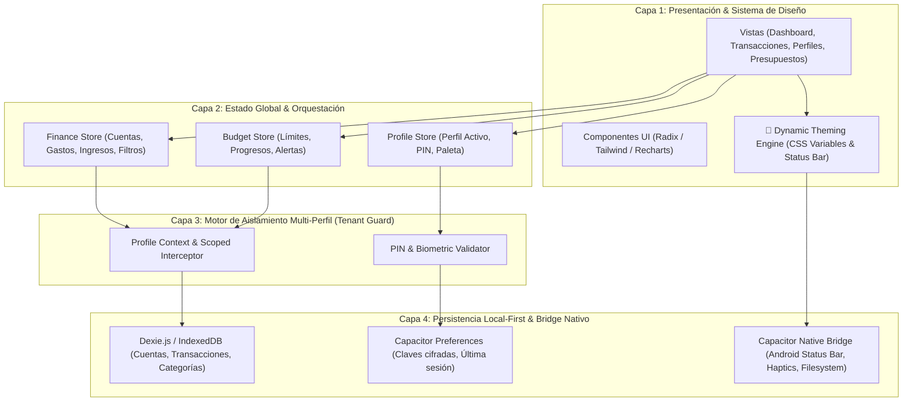

# 03. Arquitectura del Sistema y Mecanismos de Aislamiento

## 1. Visión General de la Arquitectura

Koin sigue una **Arquitectura Local-First Desacoplada** dividida en 4 capas concéntricas, asegurando que la interfaz de usuario, la lógica de negocio, el aislamiento multi-inquilino (multi-perfil) y la persistencia local funcionen de manera fluida tanto en Web como en Android.



---

## 2. Aislamiento Multi-Perfil (Tenant Isolation)

Para cumplir con el requisito estricto: *"lo usarán diferentes personas o sea cada perfil tiene que estar por separado"*:

### 2.1 Principios de Aislamiento
1. **Identificador Global Único (`profileId`)**: Toda entidad persistida en el sistema (`Account`, `Transaction`, `Category`, `Budget`, `RecurringRule`) contiene obligatoriamente una clave foránea `profileId`.
2. **Repositorio con Ámbito Automático (Scoped Repositories)**: Ninguna vista o componente consulta la base de datos de manera directa. Todas las consultas pasan por repositorios interceptados que inyectan automáticamente la cláusula `WHERE profileId = activeProfileId`.
3. **Imposibilidad de Cruce Accidental**:
   - Las cuentas bancarias de la Persona A jamás aparecen en el selector de cuentas de la Persona B.
   - Las categorías personalizadas de la Persona A pertenecen exclusivamente a su perfil.
   - Las estadísticas y gráficos de flujo de caja se calculan estrictamente sobre el subconjunto de transacciones del perfil activo.

### 2.2 Seguridad y Protección de Privacidad por Perfil
- Cada perfil puede configurarse con o sin seguridad:
  - **Sin PIN**: Acceso directo con un solo toque (ideal para perfiles rápidos propios, ej. Personal vs Trabajo).
  - **Con PIN numérico (4 o 6 dígitos)**: Bloqueo inmediato al conmutar hacia ese perfil.
  - **Biometría en Android**: Huella dactilar o reconocimiento facial disponible mediante Capacitor Biometrics.
- Al cambiar de perfil:
  1. Se bloquea el perfil saliente si tiene PIN activo.
  2. Si el perfil entrante requiere credenciales, se despliega la pantalla de desbloqueo ("Lock Screen").
  3. Una vez validado, se actualiza `activeProfileId` en el estado global.
  4. Se limpian de memoria los datos del perfil anterior y se cargan los registros del nuevo perfil.
  5. Se dispara el cambio de variables CSS para adaptar instantáneamente la paleta del perfil.

---

## 3. Motor Dinámico de Colores y Temas (Dynamic Theming Engine)

### 3.1 Funcionamiento Técnico
El diseño visual se rige mediante **Variables CSS HSL** inyectadas en tiempo de ejecución en el elemento raíz `<html>` o en el contenedor de la aplicación.

```css
:root {
  /* Variables dinámicas modificables en vivo */
  --primary: 158 64% 42%;        /* Color principal HSL */
  --primary-foreground: 0 0% 100%;
  --primary-hover: 158 64% 36%;
  --accent: 38 92% 50%;
  --background: 220 18% 10%;
  --surface: 220 18% 14%;
  --border: 220 14% 20%;
}
```

### 3.2 Paletas Preconfiguradas y Selector Libre (Color Picker)
Cada perfil almacena un objeto `themeConfig`:
- **Modo de Base**: `dark` (Oscuro profundo), `light` (Claro limpio), `amoled` (Negro puro `#000000` para ahorrar batería en pantallas OLED).
- **Color Primario (Hex o Preset)**:
  - 🌲 **Esmeralda / Menta**: `#10B981` (Finanzas clásicas / Crecimiento)
  - 💎 **Azul Zafiro / Índigo**: `#3B82F6` o `#6366F1` (Corporativo / Confianza)
  - 🍇 **Púrpura / Amatista**: `#8B5CF6` (Moderno / Exclusivo)
  - 🌅 **Atardecer Coral / Rosa**: `#F43F5E` o `#EC4899` (Creativo / Dinámico)
  - ⚡ **Ámbar / Neón Solar**: `#F59E0B` (Alerta / Vitalidad)
  - 🎨 **Personalizado (Hex Libre)**: El usuario puede elegir cualquier color `#RRGGBB`.
- **Cálculo Automático de Contraste**: El motor calcula automáticamente el tono óptimo de texto (`foreground`) con contraste WCAG AA/AAA para garantizar accesibilidad independientemente del color elegido.
- **Sincronización con Android**: Cuando se conmuta el tema o perfil en Android, `@capacitor/status-bar` y `@capacitor/navigation-bar` actualizan el color del sistema nativo del teléfono para una inmersión completa.

---

## 4. Estructura de Directorios del Proyecto

El código base se organiza bajo una arquitectura modular limpia y escalable:

```
Koin/
├── android/                         # Proyecto nativo Android generado por Capacitor
│   └── app/
├── documentation/                   # Documentación oficial del proyecto
│   ├── changelog/                   # Registro diario de cambios
│   ├── ARCHITECTURE.md              # Este documento
│   ├── DATA_MODEL.md                # Esquema de base de datos y tipos
│   ├── PROJECT_OVERVIEW.md          # Visión, objetivos y KPIs
│   ├── ROADMAP.md                   # Fases de desarrollo e hitos
│   ├── TECH_STACK_AND_EVALUATION.md # Justificación Capacitor vs React Native
│   └── UI_UX_SPECIFICATION.md       # Flujos de pantalla y diseño
├── public/                          # Activos estáticos, iconos y manifest PWA
├── src/
│   ├── assets/                      # Iconos, logos y sonidos táctiles
│   ├── components/                  # Componentes reutilizables
│   │   ├── common/                  # Botones, modales, inputs, badges
│   │   ├── finance/                 # Tarjetas de cuentas, lista de transacciones
│   │   ├── forms/                   # Teclado rápido de gastos, selector de categoría
│   │   └── layout/                  # Barra de navegación, Header, Switcher de perfil
│   ├── config/                      # Constantes globales, paletas predefinidas
│   ├── db/                          # Esquemas Dexie.js / IndexedDB, migraciones y seeds
│   │   ├── index.ts                 # Instancia principal de la base de datos
│   │   └── repositories/            # Repositorios con filtro automático por perfil
│   │       ├── account.repo.ts
│   │       ├── category.repo.ts
│   │       ├── profile.repo.ts
│   │       └── transaction.repo.ts
│   ├── hooks/                       # Hooks personalizados (useTheme, useProfile, useHaptics)
│   ├── services/                    # Puentes nativos (Capacitor StatusBar, Haptics, Backup)
│   ├── stores/                      # Estados Zustand (profileStore, financeStore, themeStore)
│   ├── types/                       # Interfaces TypeScript compartidas
│   ├── views/                       # Vistas principales de la app
│   │   ├── DashboardView.tsx        # Resumen de saldo, flujo del mes y accesos rápidos
│   │   ├── TransactionsView.tsx     # Historial detallado con filtros y búsqueda
│   │   ├── AccountsView.tsx         # Gestión de billeteras, bancos y tarjetas
│   │   ├── BudgetsView.tsx          # Presupuestos por categoría y alertas
│   │   ├── AnalyticsView.tsx        # Gráficos de gastos e ingresos
│   │   ├── ProfilesView.tsx         # Administración y cambio de perfiles
│   │   └── SettingsView.tsx         # Personalización de colores, moneda y exportación
│   ├── App.tsx                      # Enrutador principal y contenedor de tema
│   ├── index.css                    # Definición de tokens Tailwind y variables CSS
│   └── main.tsx                     # Punto de entrada Vite
├── capacitor.config.ts              # Configuración oficial de Capacitor para Android
├── index.html                       # HTML5 Shell
├── package.json                     # Dependencias y scripts de construcción
├── tailwind.config.js               # Configuración de Tailwind CSS con temas dinámicos
├── tsconfig.json                    # Configuración estricta de TypeScript
└── vite.config.ts                   # Configuración del bundler Vite
```
