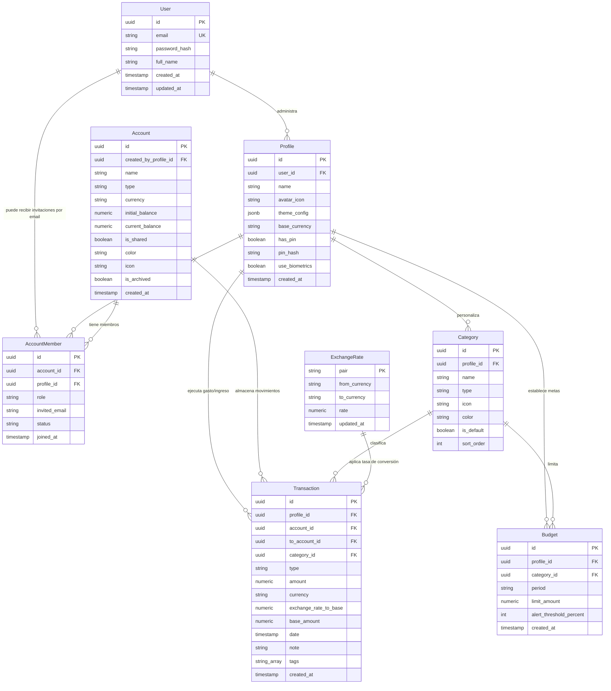

# 04. Modelo de Datos y Esquemas de Persistencia (PostgreSQL)

## 1. Diagrama Entidad-Relación (ERD)

El modelo soporta **Cuentas de Usuario (Admin)**, **Múltiples Perfiles** (estilo streaming) y **Cuentas Financieras Compartidas** mediante membresías con roles (`owner`, `editor`, `viewer`), junto con un motor **Multidivisa**.



---

## 2. Esquema DDL SQL para Heroku Postgres

```sql
CREATE EXTENSION IF NOT EXISTS "uuid-ossp";

-- 1. Tabla de Usuarios (Cuentas Principales / Titulares)
CREATE TABLE users (
    id UUID PRIMARY KEY DEFAULT uuid_generate_v4(),
    email VARCHAR(255) UNIQUE NOT NULL,
    password_hash VARCHAR(255) NOT NULL,
    full_name VARCHAR(150) NOT NULL,
    created_at TIMESTAMP WITH TIME ZONE DEFAULT NOW(),
    updated_at TIMESTAMP WITH TIME ZONE DEFAULT NOW()
);
CREATE INDEX idx_users_email ON users(email);

-- 2. Tabla de Perfiles (Dentro de cada cuenta de usuario)
CREATE TABLE profiles (
    id UUID PRIMARY KEY DEFAULT uuid_generate_v4(),
    user_id UUID NOT NULL REFERENCES users(id) ON DELETE CASCADE,
    name VARCHAR(100) NOT NULL,
    avatar_icon VARCHAR(50) NOT NULL DEFAULT 'User', -- Nombre de icono SVG Lucide (Cero Emojis)
    theme_config JSONB NOT NULL DEFAULT '{"preset":"emerald","primaryHex":"#10B981","accentHex":"#F59E0B","baseMode":"dark"}',
    base_currency VARCHAR(3) NOT NULL DEFAULT 'USD',
    has_pin BOOLEAN NOT NULL DEFAULT FALSE,
    pin_hash VARCHAR(255),
    use_biometrics BOOLEAN NOT NULL DEFAULT FALSE,
    created_at TIMESTAMP WITH TIME ZONE DEFAULT NOW(),
    updated_at TIMESTAMP WITH TIME ZONE DEFAULT NOW()
);
CREATE INDEX idx_profiles_user ON profiles(user_id);

-- 3. Tabla de Cuentas Financieras (Billeteras / Bancos / Compartidas)
CREATE TABLE accounts (
    id UUID PRIMARY KEY DEFAULT uuid_generate_v4(),
    created_by_profile_id UUID NOT NULL REFERENCES profiles(id) ON DELETE CASCADE,
    name VARCHAR(100) NOT NULL,
    type VARCHAR(20) NOT NULL CHECK (type IN ('cash', 'bank', 'credit', 'savings', 'investment')),
    currency VARCHAR(3) NOT NULL DEFAULT 'USD',
    initial_balance NUMERIC(14, 2) NOT NULL DEFAULT 0.00,
    current_balance NUMERIC(14, 2) NOT NULL DEFAULT 0.00,
    is_shared BOOLEAN NOT NULL DEFAULT FALSE,
    color VARCHAR(20) NOT NULL DEFAULT '#10B981',
    icon VARCHAR(50) NOT NULL DEFAULT 'Wallet',
    is_archived BOOLEAN NOT NULL DEFAULT FALSE,
    created_at TIMESTAMP WITH TIME ZONE DEFAULT NOW(),
    updated_at TIMESTAMP WITH TIME ZONE DEFAULT NOW()
);
CREATE INDEX idx_accounts_creator ON accounts(created_by_profile_id, is_archived);

-- 4. Tabla de Membresías y Permisos en Cuentas Compartidas
CREATE TABLE account_members (
    id UUID PRIMARY KEY DEFAULT uuid_generate_v4(),
    account_id UUID NOT NULL REFERENCES accounts(id) ON DELETE CASCADE,
    profile_id UUID REFERENCES profiles(id) ON DELETE CASCADE,
    role VARCHAR(20) NOT NULL CHECK (role IN ('owner', 'editor', 'viewer')),
    invited_email VARCHAR(255),
    status VARCHAR(20) NOT NULL DEFAULT 'accepted' CHECK (status IN ('pending', 'accepted', 'rejected')),
    created_at TIMESTAMP WITH TIME ZONE DEFAULT NOW(),
    CONSTRAINT uq_account_profile_member UNIQUE (account_id, profile_id)
);
CREATE INDEX idx_account_members_profile ON account_members(profile_id);

-- 5. Tabla de Categorías
CREATE TABLE categories (
    id UUID PRIMARY KEY DEFAULT uuid_generate_v4(),
    profile_id UUID NOT NULL REFERENCES profiles(id) ON DELETE CASCADE,
    name VARCHAR(100) NOT NULL,
    type VARCHAR(20) NOT NULL CHECK (type IN ('expense', 'income')),
    icon VARCHAR(50) NOT NULL DEFAULT 'Tag',
    color VARCHAR(20) NOT NULL DEFAULT '#6B7280',
    is_default BOOLEAN NOT NULL DEFAULT FALSE,
    sort_order INT NOT NULL DEFAULT 0,
    created_at TIMESTAMP WITH TIME ZONE DEFAULT NOW()
);
CREATE INDEX idx_categories_profile ON categories(profile_id, type);

-- 6. Tabla de Tasas de Cambio Multidivisa
CREATE TABLE exchange_rates (
    pair VARCHAR(7) PRIMARY KEY, -- Ej: 'USD_COP', 'EUR_USD'
    from_currency VARCHAR(3) NOT NULL,
    to_currency VARCHAR(3) NOT NULL,
    rate NUMERIC(18, 6) NOT NULL,
    updated_at TIMESTAMP WITH TIME ZONE DEFAULT NOW()
);

-- 7. Tabla de Transacciones
CREATE TABLE transactions (
    id UUID PRIMARY KEY DEFAULT uuid_generate_v4(),
    profile_id UUID NOT NULL REFERENCES profiles(id) ON DELETE RESTRICT,
    account_id UUID NOT NULL REFERENCES accounts(id) ON DELETE RESTRICT,
    to_account_id UUID REFERENCES accounts(id) ON DELETE RESTRICT,
    category_id UUID NOT NULL REFERENCES categories(id) ON DELETE RESTRICT,
    type VARCHAR(20) NOT NULL CHECK (type IN ('expense', 'income', 'transfer')),
    amount NUMERIC(14, 2) NOT NULL CHECK (amount > 0),
    currency VARCHAR(3) NOT NULL DEFAULT 'USD',
    exchange_rate_to_base NUMERIC(18, 6) NOT NULL DEFAULT 1.000000,
    base_amount NUMERIC(14, 2) NOT NULL, -- Monto normalizado a la moneda base del perfil
    date TIMESTAMP WITH TIME ZONE NOT NULL DEFAULT NOW(),
    note TEXT,
    tags TEXT[],
    is_recurring BOOLEAN NOT NULL DEFAULT FALSE,
    created_at TIMESTAMP WITH TIME ZONE DEFAULT NOW(),
    updated_at TIMESTAMP WITH TIME ZONE DEFAULT NOW()
);
CREATE INDEX idx_transactions_profile_date ON transactions(profile_id, date DESC);
CREATE INDEX idx_transactions_account_date ON transactions(account_id, date DESC);

-- 8. Tabla de Presupuestos
CREATE TABLE budgets (
    id UUID PRIMARY KEY DEFAULT uuid_generate_v4(),
    profile_id UUID NOT NULL REFERENCES profiles(id) ON DELETE CASCADE,
    category_id UUID NOT NULL REFERENCES categories(id) ON DELETE CASCADE,
    period VARCHAR(20) NOT NULL DEFAULT 'monthly' CHECK (period IN ('monthly', 'weekly')),
    limit_amount NUMERIC(14, 2) NOT NULL CHECK (limit_amount > 0),
    alert_threshold_percent INT NOT NULL DEFAULT 80,
    created_at TIMESTAMP WITH TIME ZONE DEFAULT NOW(),
    updated_at TIMESTAMP WITH TIME ZONE DEFAULT NOW(),
    CONSTRAINT uq_profile_category_budget UNIQUE (profile_id, category_id, period)
);
```

---

## 3. Esquemas Drizzle ORM (`apps/server/src/db/schema.ts`)

```typescript
import { pgTable, uuid, varchar, numeric, boolean, timestamp, jsonb, text, integer } from 'drizzle-orm/pg-core';
import { relations } from 'drizzle-orm';

// 1. Usuarios
export const users = pgTable('users', {
  id: uuid('id').defaultRandom().primaryKey(),
  email: varchar('email', { length: 255 }).notNull().unique(),
  passwordHash: varchar('password_hash', { length: 255 }).notNull(),
  fullName: varchar('full_name', { length: 150 }).notNull(),
  createdAt: timestamp('created_at', { withTimezone: true }).defaultNow().notNull(),
  updatedAt: timestamp('updated_at', { withTimezone: true }).defaultNow().notNull(),
});

// 2. Perfiles
export const profiles = pgTable('profiles', {
  id: uuid('id').defaultRandom().primaryKey(),
  userId: uuid('user_id').references(() => users.id, { onDelete: 'cascade' }).notNull(),
  name: varchar('name', { length: 100 }).notNull(),
  avatarIcon: varchar('avatar_icon', { length: 50 }).default('User').notNull(), // Icono SVG Lucide
  themeConfig: jsonb('theme_config').notNull(),
  baseCurrency: varchar('base_currency', { length: 3 }).default('USD').notNull(),
  hasPin: boolean('has_pin').default(false).notNull(),
  pinHash: varchar('pin_hash', { length: 255 }),
  useBiometrics: boolean('use_biometrics').default(false).notNull(),
  createdAt: timestamp('created_at', { withTimezone: true }).defaultNow().notNull(),
  updatedAt: timestamp('updated_at', { withTimezone: true }).defaultNow().notNull(),
});

// 3. Cuentas Financieras
export const accounts = pgTable('accounts', {
  id: uuid('id').defaultRandom().primaryKey(),
  createdByProfileId: uuid('created_by_profile_id').references(() => profiles.id, { onDelete: 'cascade' }).notNull(),
  name: varchar('name', { length: 100 }).notNull(),
  type: varchar('type', { length: 20 }).notNull(), // 'cash', 'bank', etc.
  currency: varchar('currency', { length: 3 }).default('USD').notNull(),
  initialBalance: numeric('initial_balance', { precision: 14, scale: 2 }).default('0.00').notNull(),
  currentBalance: numeric('current_balance', { precision: 14, scale: 2 }).default('0.00').notNull(),
  isShared: boolean('is_shared').default(false).notNull(),
  color: varchar('color', { length: 20 }).default('#10B981').notNull(),
  icon: varchar('icon', { length: 50 }).default('Wallet').notNull(),
  isArchived: boolean('is_archived').default(false).notNull(),
  createdAt: timestamp('created_at', { withTimezone: true }).defaultNow().notNull(),
});

// 4. Miembros de Cuentas Compartidas
export const accountMembers = pgTable('account_members', {
  id: uuid('id').defaultRandom().primaryKey(),
  accountId: uuid('account_id').references(() => accounts.id, { onDelete: 'cascade' }).notNull(),
  profileId: uuid('profile_id').references(() => profiles.id, { onDelete: 'cascade' }),
  role: varchar('role', { length: 20 }).notNull(), // 'owner', 'editor', 'viewer'
  invitedEmail: varchar('invited_email', { length: 255 }),
  status: varchar('status', { length: 20 }).default('accepted').notNull(),
  createdAt: timestamp('created_at', { withTimezone: true }).defaultNow().notNull(),
});

// 5. Transacciones
export const transactions = pgTable('transactions', {
  id: uuid('id').defaultRandom().primaryKey(),
  profileId: uuid('profile_id').references(() => profiles.id).notNull(),
  accountId: uuid('account_id').references(() => accounts.id).notNull(),
  toAccountId: uuid('to_account_id').references(() => accounts.id),
  categoryId: uuid('category_id').references(() => categories.id).notNull(),
  type: varchar('type', { length: 20 }).notNull(), // 'expense', 'income', 'transfer'
  amount: numeric('amount', { precision: 14, scale: 2 }).notNull(),
  currency: varchar('currency', { length: 3 }).default('USD').notNull(),
  exchangeRateToBase: numeric('exchange_rate_to_base', { precision: 18, scale: 6 }).default('1.000000').notNull(),
  baseAmount: numeric('base_amount', { precision: 14, scale: 2 }).notNull(),
  date: timestamp('date', { withTimezone: true }).defaultNow().notNull(),
  note: text('note'),
  tags: text('tags').array(),
  isRecurring: boolean('is_recurring').default(false).notNull(),
  createdAt: timestamp('created_at', { withTimezone: true }).defaultNow().notNull(),
});

// 6. Tasas de Cambio
export const exchangeRates = pgTable('exchange_rates', {
  pair: varchar('pair', { length: 7 }).primaryKey(),
  fromCurrency: varchar('from_currency', { length: 3 }).notNull(),
  toCurrency: varchar('to_currency', { length: 3 }).notNull(),
  rate: numeric('rate', { precision: 18, scale: 6 }).notNull(),
  updatedAt: timestamp('updated_at', { withTimezone: true }).defaultNow().notNull(),
});
```
