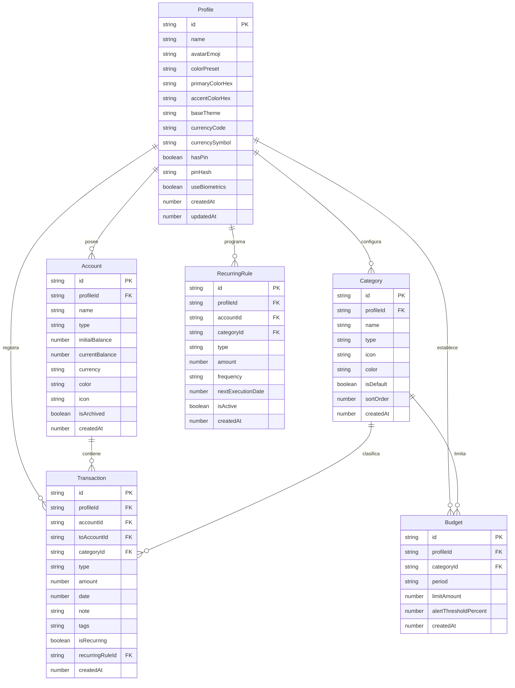

# 04. Modelo de Datos y Esquemas de Persistencia

## 1. Diagrama Entidad-Relación (ERD)

Cada entidad de negocio posee una relación obligatoria de pertenencia con `Profile`. No existen registros globales o compartidos sin pertenencia explícita.



---

## 2. Definiciones de Tipos en TypeScript

```typescript
// ==========================================
// 1. Perfil y Personalización
// ==========================================
export type BaseThemeMode = 'dark' | 'light' | 'amoled';

export interface ProfileTheme {
  preset: 'emerald' | 'sapphire' | 'amethyst' | 'coral' | 'amber' | 'custom';
  primaryHex: string;       // Ej. "#10B981"
  accentHex: string;        // Ej. "#F59E0B"
  baseMode: BaseThemeMode;   // 'dark' | 'light' | 'amoled'
}

export interface Profile {
  id: string;               // UUID v4
  name: string;             // Nombre visible (ej: "Dylan", "María", "Negocio")
  avatarEmoji: string;      // Emoji identificador (ej: "🦁", "💼", "🚀")
  theme: ProfileTheme;
  currencyCode: string;     // ISO 4217 (ej: "USD", "COP", "EUR", "MXN")
  currencySymbol: string;   // "$", "€", etc.
  hasPin: boolean;          // Indica si requiere PIN para entrar
  pinHash?: string;         // Hash SHA-256 + Salt local
  useBiometrics: boolean;   // Huella/FaceID en Android
  createdAt: number;        // Epoch timestamp en milisegundos
  updatedAt: number;
}

// ==========================================
// 2. Cuentas y Billeteras
// ==========================================
export type AccountType = 'cash' | 'bank' | 'credit' | 'savings' | 'investment';

export interface Account {
  id: string;
  profileId: string;        // Aislamiento por perfil
  name: string;             // "Efectivo", "Nequi", "BBVA Ahorros"
  type: AccountType;
  initialBalance: number;   // Saldo con el que inició la cuenta
  currentBalance: number;   // Saldo en tiempo real derivado de transacciones
  currency: string;
  color: string;            // Distintivo visual de la tarjeta
  icon: string;             // Nombre del icono Lucide (ej: "Wallet", "CreditCard")
  isArchived: boolean;
  createdAt: number;
  updatedAt: number;
}

// ==========================================
// 3. Categorías
// ==========================================
export type TransactionType = 'expense' | 'income' | 'transfer';

export interface Category {
  id: string;
  profileId: string;        // Aislamiento por perfil
  name: string;             // "Supermercado", "Restaurante", "Nómina", "Transporte"
  type: 'expense' | 'income';
  icon: string;             // Nombre de icono Lucide
  color: string;            // Color del badge
  isDefault: boolean;       // Si viene precargada o fue creada por el usuario
  sortOrder: number;
  createdAt: number;
}

// ==========================================
// 4. Transacciones (Movimientos Financieros)
// ==========================================
export interface Transaction {
  id: string;
  profileId: string;        // Aislamiento estricto: OBLIGATORIO
  accountId: string;        // Cuenta origen
  toAccountId?: string;     // Cuenta destino (únicamente si type === 'transfer')
  categoryId: string;       // Categoría asociada
  type: TransactionType;
  amount: number;           // Monto absoluto en centavos o decimales de precisión
  date: number;             // Timestamp milisegundos del gasto
  note?: string;            // Descripción opcional (ej: "Almuerzo con clientes")
  tags?: string[];          // Etiquetas libres (ej: ["viaje", "deducible"])
  isRecurring: boolean;
  recurringRuleId?: string;
  createdAt: number;
  updatedAt: number;
}

// ==========================================
// 5. Presupuestos y Límites de Gasto
// ==========================================
export interface Budget {
  id: string;
  profileId: string;        // Aislamiento por perfil
  categoryId: string;       // Categoría a la que aplica o 'all' para presupuesto global
  period: 'monthly' | 'weekly';
  limitAmount: number;      // Límite fijado (ej: 500.00)
  alertThresholdPercent: number; // Porcentaje para alerta (ej: 80 para avisar al 80%)
  createdAt: number;
  updatedAt: number;
}
```

---

## 3. Esquema de Base de Datos IndexedDB (Dexie.js)

Para garantizar velocidad instantánea en consultas (sin retrasos al filtrar meses o buscar transacciones), se definen índices compuestos optimizados:

```typescript
import Dexie, { Table } from 'dexie';

export class KoinDatabase extends Dexie {
  profiles!: Table<Profile, string>;
  accounts!: Table<Account, string>;
  categories!: Table<Category, string>;
  transactions!: Table<Transaction, string>;
  budgets!: Table<Budget, string>;

  constructor() {
    super('KoinDB');
    this.version(1).stores({
      profiles: 'id, name, createdAt',
      accounts: 'id, profileId, type, isArchived, [profileId+isArchived]',
      categories: 'id, profileId, type, sortOrder, [profileId+type]',
      transactions: 'id, profileId, accountId, categoryId, type, date, [profileId+date], [profileId+type], [profileId+categoryId]',
      budgets: 'id, profileId, categoryId, [profileId+categoryId]'
    });
  }
}

export const db = new KoinDatabase();
```

### Índices Críticos para Rendimiento
- `[profileId+date]`: Permite cargar el historial del mes del perfil activo en **< 5 milisegundos** sin recorrer toda la base de datos.
- `[profileId+type]`: Permite calcular el total de ingresos o gastos acumulados del perfil de forma indexada.
- `[profileId+isArchived]`: Filtra al instante las cuentas activas para el conmutador de cuentas.

---

## 4. Semillas Preconfiguradas (Seeds por Defecto al Crear un Perfil)

Al crear un nuevo perfil (o en el primer inicio de la app), se inicializan automáticamente:
1. **Cuentas por defecto**:
   - "Efectivo" (Tipo: Cash, Icono: `Wallet`, Color: Verde)
   - "Cuenta Bancaria" (Tipo: Bank, Icono: `Landmark`, Color: Azul)
2. **Categorías de Gasto estándar**:
   - 🍔 Alimentación y Mercado (`UtensilsCrossed`)
   - 🚗 Transporte y Movilidad (`Car`)
   - 🏠 Vivienda y Servicios (`Home`)
   - 🍿 Entretenimiento y Salidas (`Popcorn`)
   - 💊 Salud y Farmacia (`HeartPulse`)
   - 🛍️ Compras y Ropa (`ShoppingBag`)
3. **Categorías de Ingreso estándar**:
   - 💼 Salario / Nómina (`Briefcase`)
   - 📈 Inversiones / Rendimientos (`TrendingUp`)
   - 🎁 Otros Ingresos (`Coins`)
