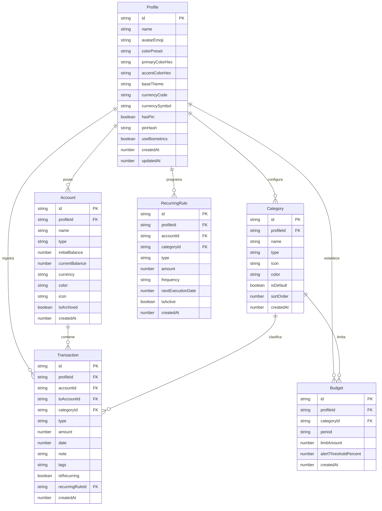

# 04. Modelo de Datos y Esquemas de Persistencia

## 1. Diagrama Entidad-Relación (ERD)

Cada entidad de negocio posee una relación obligatoria de pertenencia con `Profile`. No existen registros globales o compartidos sin pertenencia explícita.



---

## 2. Definiciones de Tipos en TypeScript

```typescript
// ==========================================
// 1. Perfil y Personalización
// ==========================================
export type BaseThemeMode = 'dark' | 'light' | 'amoled';

export interface ProfileTheme {
  preset: 'emerald' | 'sapphire' | 'amethyst' | 'coral' | 'amber' | 'custom';
  primaryHex: string;       // Ej. "#10B981"
  accentHex: string;        // Ej. "#F59E0B"
  baseMode: BaseThemeMode;   // 'dark' | 'light' | 'amoled'
}

export interface Profile {
  id: string;               // UUID v4
  name: string;             // Nombre visible (ej: "Dylan", "María", "Negocio")
  avatarEmoji: string;      // Emoji identificador (ej: "🦁", "💼", "🚀")
  theme: ProfileTheme;
  currencyCode: string;     // ISO 4217 (ej: "USD", "COP", "EUR", "MXN")
  currencySymbol: string;   // "$", "€", etc.
  hasPin: boolean;          // Indica si requiere PIN para entrar
  pinHash?: string;         // Hash SHA-256 + Salt local
  useBiometrics: boolean;   // Huella/FaceID en Android
  createdAt: number;        // Epoch timestamp en milisegundos
  updatedAt: number;
}

// ==========================================
// 2. Cuentas y Billeteras
// ==========================================
export type AccountType = 'cash' | 'bank' | 'credit' | 'savings' | 'investment';

export interface Account {
  id: string;
  profileId: string;        // Aislamiento por perfil
  name: string;             // "Efectivo", "Nequi", "BBVA Ahorros"
  type: AccountType;
  initialBalance: number;   // Saldo con el que inició la cuenta
  currentBalance: number;   // Saldo en tiempo real derivado de transacciones
  currency: string;
  color: string;            // Distintivo visual de la tarjeta
  icon: string;             // Nombre del icono Lucide (ej: "Wallet", "CreditCard")
  isArchived: boolean;
  createdAt: number;
  updatedAt: number;
}

// ==========================================
// 3. Categorías
// ==========================================
export type TransactionType = 'expense' | 'income' | 'transfer';

export interface Category {
  id: string;
  profileId: string;        // Aislamiento por perfil
  name: string;             // "Supermercado", "Restaurante", "Nómina", "Transporte"
  type: 'expense' | 'income';
  icon: string;             // Nombre de icono Lucide
  color: string;            // Color del badge
  isDefault: boolean;       // Si viene precargada o fue creada por el usuario
  sortOrder: number;
  createdAt: number;
}

// ==========================================
// 4. Transacciones (Movimientos Financieros)
// ==========================================
export interface Transaction {
  id: string;
  profileId: string;        // Aislamiento estricto: OBLIGATORIO
  accountId: string;        // Cuenta origen
  toAccountId?: string;     // Cuenta destino (únicamente si type === 'transfer')
  categoryId: string;       // Categoría asociada
  type: TransactionType;
  amount: number;           // Monto absoluto en centavos o decimales de precisión
  date: number;             // Timestamp milisegundos del gasto
  note?: string;            // Descripción opcional (ej: "Almuerzo con clientes")
  tags?: string[];          // Etiquetas libres (ej: ["viaje", "deducible"])
  isRecurring: boolean;
  recurringRuleId?: string;
  createdAt: number;
  updatedAt: number;
}

// ==========================================
// 5. Presupuestos y Límites de Gasto
// ==========================================
export interface Budget {
  id: string;
  profileId: string;        // Aislamiento por perfil
  categoryId: string;       // Categoría a la que aplica o 'all' para presupuesto global
  period: 'monthly' | 'weekly';
  limitAmount: number;      // Límite fijado (ej: 500.00)
  alertThresholdPercent: number; // Porcentaje para alerta (ej: 80 para avisar al 80%)
  createdAt: number;
  updatedAt: number;
}
```

---

## 3. Esquema Relacional PostgreSQL (Heroku Postgres DDL & Drizzle ORM)

Dado que la aplicación se montará en **Heroku**, la base de datos principal es **PostgreSQL**. Todos los montos financieros se almacenan con tipo `NUMERIC(12, 2)` para evitar pérdidas de precisión de punto flotante.

### 3.1 DDL SQL para PostgreSQL
```sql
-- Habilitar extensión UUID
CREATE EXTENSION IF NOT EXISTS "uuid-ossp";

-- 1. Tabla de Perfiles
CREATE TABLE profiles (
    id UUID PRIMARY KEY DEFAULT uuid_generate_v4(),
    name VARCHAR(100) NOT NULL,
    avatar_emoji VARCHAR(10) NOT NULL DEFAULT '👤',
    theme_config JSONB NOT NULL DEFAULT '{"preset":"emerald","primaryHex":"#10B981","accentHex":"#F59E0B","baseMode":"dark"}',
    currency_code VARCHAR(3) NOT NULL DEFAULT 'USD',
    currency_symbol VARCHAR(5) NOT NULL DEFAULT '$',
    has_pin BOOLEAN NOT NULL DEFAULT FALSE,
    pin_hash VARCHAR(255),
    use_biometrics BOOLEAN NOT NULL DEFAULT FALSE,
    created_at TIMESTAMP WITH TIME ZONE DEFAULT NOW(),
    updated_at TIMESTAMP WITH TIME ZONE DEFAULT NOW()
);

-- 2. Tabla de Cuentas Financieras
CREATE TABLE accounts (
    id UUID PRIMARY KEY DEFAULT uuid_generate_v4(),
    profile_id UUID NOT NULL REFERENCES profiles(id) ON DELETE CASCADE,
    name VARCHAR(100) NOT NULL,
    type VARCHAR(20) NOT NULL CHECK (type IN ('cash', 'bank', 'credit', 'savings', 'investment')),
    initial_balance NUMERIC(12, 2) NOT NULL DEFAULT 0.00,
    current_balance NUMERIC(12, 2) NOT NULL DEFAULT 0.00,
    currency VARCHAR(3) NOT NULL DEFAULT 'USD',
    color VARCHAR(20) NOT NULL DEFAULT '#10B981',
    icon VARCHAR(50) NOT NULL DEFAULT 'Wallet',
    is_archived BOOLEAN NOT NULL DEFAULT FALSE,
    created_at TIMESTAMP WITH TIME ZONE DEFAULT NOW(),
    updated_at TIMESTAMP WITH TIME ZONE DEFAULT NOW()
);
CREATE INDEX idx_accounts_profile ON accounts(profile_id, is_archived);

-- 3. Tabla de Categorías
CREATE TABLE categories (
    id UUID PRIMARY KEY DEFAULT uuid_generate_v4(),
    profile_id UUID NOT NULL REFERENCES profiles(id) ON DELETE CASCADE,
    name VARCHAR(100) NOT NULL,
    type VARCHAR(20) NOT NULL CHECK (type IN ('expense', 'income')),
    icon VARCHAR(50) NOT NULL DEFAULT 'Tag',
    color VARCHAR(20) NOT NULL DEFAULT '#6B7280',
    is_default BOOLEAN NOT NULL DEFAULT FALSE,
    sort_order INT NOT NULL DEFAULT 0,
    created_at TIMESTAMP WITH TIME ZONE DEFAULT NOW()
);
CREATE INDEX idx_categories_profile_type ON categories(profile_id, type);

-- 4. Tabla de Transacciones
CREATE TABLE transactions (
    id UUID PRIMARY KEY DEFAULT uuid_generate_v4(),
    profile_id UUID NOT NULL REFERENCES profiles(id) ON DELETE CASCADE,
    account_id UUID NOT NULL REFERENCES accounts(id) ON DELETE RESTRICT,
    to_account_id UUID REFERENCES accounts(id) ON DELETE RESTRICT,
    category_id UUID NOT NULL REFERENCES categories(id) ON DELETE RESTRICT,
    type VARCHAR(20) NOT NULL CHECK (type IN ('expense', 'income', 'transfer')),
    amount NUMERIC(12, 2) NOT NULL CHECK (amount > 0),
    date TIMESTAMP WITH TIME ZONE NOT NULL DEFAULT NOW(),
    note TEXT,
    tags TEXT[],
    is_recurring BOOLEAN NOT NULL DEFAULT FALSE,
    created_at TIMESTAMP WITH TIME ZONE DEFAULT NOW(),
    updated_at TIMESTAMP WITH TIME ZONE DEFAULT NOW()
);
CREATE INDEX idx_transactions_profile_date ON transactions(profile_id, date DESC);
CREATE INDEX idx_transactions_profile_type ON transactions(profile_id, type);
CREATE INDEX idx_transactions_profile_category ON transactions(profile_id, category_id);

-- 5. Tabla de Presupuestos
CREATE TABLE budgets (
    id UUID PRIMARY KEY DEFAULT uuid_generate_v4(),
    profile_id UUID NOT NULL REFERENCES profiles(id) ON DELETE CASCADE,
    category_id UUID NOT NULL REFERENCES categories(id) ON DELETE CASCADE,
    period VARCHAR(20) NOT NULL DEFAULT 'monthly' CHECK (period IN ('monthly', 'weekly')),
    limit_amount NUMERIC(12, 2) NOT NULL CHECK (limit_amount > 0),
    alert_threshold_percent INT NOT NULL DEFAULT 80,
    created_at TIMESTAMP WITH TIME ZONE DEFAULT NOW(),
    updated_at TIMESTAMP WITH TIME ZONE DEFAULT NOW(),
    CONSTRAINT uq_profile_category_budget UNIQUE (profile_id, category_id, period)
);
```

### 3.2 Esquema Drizzle ORM (`server/src/db/schema.ts`)
```typescript
import { pgTable, uuid, varchar, numeric, boolean, timestamp, jsonb, text } from 'drizzle-orm/pg-core';

export const profiles = pgTable('profiles', {
  id: uuid('id').defaultRandom().primaryKey(),
  name: varchar('name', { length: 100 }).notNull(),
  avatarEmoji: varchar('avatar_emoji', { length: 10 }).default('👤').notNull(),
  themeConfig: jsonb('theme_config').notNull(),
  currencyCode: varchar('currency_code', { length: 3 }).default('USD').notNull(),
  currencySymbol: varchar('currency_symbol', { length: 5 }).default('$').notNull(),
  hasPin: boolean('has_pin').default(false).notNull(),
  pinHash: varchar('pin_hash', { length: 255 }),
  useBiometrics: boolean('use_biometrics').default(false).notNull(),
  createdAt: timestamp('created_at', { withTimezone: true }).defaultNow().notNull(),
  updatedAt: timestamp('updated_at', { withTimezone: true }).defaultNow().notNull(),
});

export const accounts = pgTable('accounts', {
  id: uuid('id').defaultRandom().primaryKey(),
  profileId: uuid('profile_id').references(() => profiles.id, { onDelete: 'cascade' }).notNull(),
  name: varchar('name', { length: 100 }).notNull(),
  type: varchar('type', { length: 20 }).notNull(),
  initialBalance: numeric('initial_balance', { precision: 12, scale: 2 }).default('0.00').notNull(),
  currentBalance: numeric('current_balance', { precision: 12, scale: 2 }).default('0.00').notNull(),
  currency: varchar('currency', { length: 3 }).default('USD').notNull(),
  color: varchar('color', { length: 20 }).default('#10B981').notNull(),
  icon: varchar('icon', { length: 50 }).default('Wallet').notNull(),
  isArchived: boolean('is_archived').default(false).notNull(),
  createdAt: timestamp('created_at', { withTimezone: true }).defaultNow().notNull(),
});

export const transactions = pgTable('transactions', {
  id: uuid('id').defaultRandom().primaryKey(),
  profileId: uuid('profile_id').references(() => profiles.id, { onDelete: 'cascade' }).notNull(),
  accountId: uuid('account_id').references(() => accounts.id).notNull(),
  toAccountId: uuid('to_account_id').references(() => accounts.id),
  categoryId: uuid('category_id').references(() => categories.id).notNull(),
  type: varchar('type', { length: 20 }).notNull(),
  amount: numeric('amount', { precision: 12, scale: 2 }).notNull(),
  date: timestamp('date', { withTimezone: true }).defaultNow().notNull(),
  note: text('note'),
  tags: text('tags').array(),
  isRecurring: boolean('is_recurring').default(false).notNull(),
  createdAt: timestamp('created_at', { withTimezone: true }).defaultNow().notNull(),
});
```

---

## 4. Esquema de Cache Local en Cliente (Dexie.js / IndexedDB)

Para mantener la velocidad de registro (<3 segundos) e inmunidad a cortes de red en móviles, el cliente mantiene una copia local sincronizable mediante Dexie.js:

```typescript
import Dexie, { Table } from 'dexie';

export class KoinClientDatabase extends Dexie {
  profiles!: Table<Profile, string>;
  accounts!: Table<Account, string>;
  categories!: Table<Category, string>;
  transactions!: Table<Transaction, string>;
  budgets!: Table<Budget, string>;
  syncQueue!: Table<{ id: string; action: string; entity: string; payload: any; timestamp: number }, string>;

  constructor() {
    super('KoinClientDB');
    this.version(1).stores({
      profiles: 'id, name, createdAt',
      accounts: 'id, profileId, type, isArchived, [profileId+isArchived]',
      categories: 'id, profileId, type, sortOrder, [profileId+type]',
      transactions: 'id, profileId, accountId, categoryId, type, date, [profileId+date], [profileId+type]',
      budgets: 'id, profileId, categoryId, [profileId+categoryId]',
      syncQueue: 'id, action, timestamp'
    });
  }
}

export const clientDb = new KoinClientDatabase();
```

---

## 4. Semillas Preconfiguradas (Seeds por Defecto al Crear un Perfil)

Al crear un nuevo perfil (o en el primer inicio de la app), se inicializan automáticamente:
1. **Cuentas por defecto**:
   - "Efectivo" (Tipo: Cash, Icono: `Wallet`, Color: Verde)
   - "Cuenta Bancaria" (Tipo: Bank, Icono: `Landmark`, Color: Azul)
2. **Categorías de Gasto estándar**:
   - 🍔 Alimentación y Mercado (`UtensilsCrossed`)
   - 🚗 Transporte y Movilidad (`Car`)
   - 🏠 Vivienda y Servicios (`Home`)
   - 🍿 Entretenimiento y Salidas (`Popcorn`)
   - 💊 Salud y Farmacia (`HeartPulse`)
   - 🛍️ Compras y Ropa (`ShoppingBag`)
3. **Categorías de Ingreso estándar**:
   - 💼 Salario / Nómina (`Briefcase`)
   - 📈 Inversiones / Rendimientos (`TrendingUp`)
   - 🎁 Otros Ingresos (`Coins`)
