# 06. Hoja de Ruta de Desarrollo (Roadmap de Implementación)

Este documento estructura el plan de ejecución por fases para desarrollar **Koin** de forma ágil, modular y verificable.

---

## 📅 Resumen de Fases

```mermaid
gantt
    title Plan de Desarrollo Koin (Web + Android)
    dateFormat  X
    axisFormat %d
    section Fase 1
    Scaffolding y Motor de Temas        :active, p1, 0, 3
    section Fase 2
    Multi-Perfil y Aislamiento          :p2, after p1, 3
    section Fase 3
    Núcleo Financiero Ultrarrápido      :p3, after p2, 4
    section Fase 4
    Presupuestos y Analíticas Visuales  :p4, after p3, 3
    section Fase 5
    Empaquetado Android con Capacitor   :p5, after p4, 3
    section Fase 6
    Backups, PWA y Pulido Final         :p6, after p5, 2
```

---

## 🛠️ Detalle de Fases y Entregables

### Fase 1: Andamiaje del Proyecto y Motor Dinámico de Temas
- [ ] Inicialización del proyecto con **Vite + React 19/18 + TypeScript estricto**.
- [ ] Configuración de **Tailwind CSS** con soporte de variables CSS HSL dinámicas (`--primary`, `--accent`, etc.).
- [ ] Creación de `ThemeEngine`: convertidor Hex-a-HSL, verificador de contraste WCAG y selector de modo (Dark / Light / AMOLED).
- [ ] Implementación de la base de datos local **Dexie.js (IndexedDB)** con tablas indexadas.

### Fase 2: Módulo Multi-Perfil con Aislamiento Estricto
- [ ] Implementación de `ProfileStore` con Zustand.
- [ ] Creación y edición de perfiles (Nombre, Avatar Emoji, Paleta de Color, Moneda).
- [ ] Selector visual de perfiles (Bottom Sheet) y conmutación instantánea de contexto.
- [ ] Capa de seguridad opcional: Bloqueo por PIN de 4/6 dígitos por perfil y teclado numérico seguro.
- [ ] Middleware / Repositorios con filtro automático `where('profileId').equals(activeProfileId)`.

### Fase 3: Núcleo Financiero Ultrarrápido (Core Finance)
- [ ] **Modal de Registro en < 3 Segundos**:
  - Teclado numérico táctil optimizado en pantalla.
  - Chips de montos rápidos ($5, $10, $20, $50).
  - Selector de categorías más frecuentes con guardado en 1 toque.
- [ ] Gestión de Cuentas / Billeteras (Efectivo, Cuentas Bancarias, Tarjetas de Crédito).
- [ ] Gestión de Categorías personalizadas con iconos de Lucide.
- [ ] Historial de Transacciones con búsqueda instantánea, paginación virtual y filtros.

### Fase 4: Presupuestos y Analíticas Visuales
- [ ] Módulo de Presupuestos mensuales por categoría con alertas visuales de exceso.
- [ ] Integración de **Recharts**:
  - Gráfico de dona de distribución de gastos por categoría.
  - Gráfico de barras de flujo de caja neto mensual (Ingresos vs Gastos).
- [ ] Balance acumulado y proyección de ahorros del perfil activo.

### Fase 5: Integración Nativa Android con Capacitor
- [ ] Inicialización de Capacitor: `npx cap init Koin com.koin.finance`.
- [ ] Adición de plataforma Android: `npx cap add android`.
- [ ] Configuración de plugins nativos:
  - `@capacitor/status-bar`: Sincronización del color de la barra del sistema con el tema activo.
  - `@capacitor/haptics`: Vibraciones táctiles al teclear y guardar movimientos.
  - `@capacitor/keyboard`: Ajuste automático de scroll al desplegar teclado.
- [ ] Generación y prueba del APK de depuración para Android.

### Fase 6: Respaldos, Exportación y Modo PWA
- [ ] Exportación e importación de datos en formato JSON (por perfil o base completa).
- [ ] Exportación de transacciones a formato CSV para Excel/Sheets.
- [ ] Configuración del Web App Manifest y Service Worker para funcionamiento como PWA instalable en escritorio y navegadores móviles.
- [ ] Pruebas finales de estrés de memoria y tiempos de respuesta.
