# 06. Hoja de Ruta de Desarrollo (Roadmap de Implementación)

Este documento estructura el plan de ejecución por fases para desarrollar **Koin** utilizando **Turborepo**, **Express.js**, **React + Vite**, **Capacitor** y **Heroku Postgres**.

---

## 📅 Resumen de Fases

```mermaid
gantt
    title Plan de Desarrollo Koin (Turborepo + Web + Android)
    dateFormat  X
    axisFormat %d
    section Fase 1
    Monorepo Turborepo, Backend Express & Temas  :active, p1, 0, 3
    section Fase 2
    Auth Usuarios, Perfiles & Cuentas Compartidas :p2, after p1, 4
    section Fase 3
    Motor Multidivisa y Núcleo Financiero       :p3, after p2, 4
    section Fase 4
    Presupuestos, Analíticas & Swagger Docs      :p4, after p3, 3
    section Fase 5
    Empaquetado Android con Capacitor           :p5, after p4, 3
    section Fase 6
    Despliegue en Heroku & Pruebas E2E           :p6, after p5, 2
```

---

## 🛠️ Detalle de Fases y Entregables

### Fase 1: Andamiaje del Monorepo con Turborepo, Express y Motor de Temas
- [ ] Inicialización del Monorepo con **Turborepo** y npm workspaces:
  - `apps/server`: Express.js + TypeScript + Drizzle ORM.
  - `apps/web`: React + Vite + Tailwind CSS + TanStack Query.
  - `packages/shared`: Tipos comunes TypeScript y esquemas de validación Zod.
- [ ] Configuración del pipeline de seguridad en Express (`helmet`, `cors`, `express-rate-limit`, `hpp`).
- [ ] Configuración de la base de datos **Heroku Postgres** (conexión SSL con pool de conexiones).
- [ ] Implementación del `ThemeEngine` en frontend con variables CSS HSL dinámicas y soporte de paletas por perfil.

### Fase 2: Autenticación de Cuentas, Perfiles Estilo Streaming y Cuentas Compartidas
- [ ] **Módulo de Usuarios**:
  - Registro (Sign-Up) e Inicio de Sesión (Sign-In) con email y contraseña hasheada con **Argon2id**.
  - Emisión y verificación de JWT seguro.
- [ ] **Módulo de Múltiples Perfiles**:
  - Creación de perfiles dentro de la cuenta del usuario (Avatar, Nombre, Paleta de Color, Moneda Base).
  - PIN de seguridad opcional por perfil con protección contra ataques de tiempo y bloqueo tras 5 intentos.
  - Selector visual de perfiles (estilo streaming) y conmutación instantánea.
- [ ] **Cuentas Financieras Privadas vs Compartidas**:
  - Creación de cuentas (Efectivo, Bancos, Tarjetas).
  - Sistema de invitaciones a otros perfiles/usuarios para co-administrar cuentas compartidas.
  - Roles de membresía: `owner`, `editor` y `viewer` con middleware de autorización RBAC.

### Fase 3: Motor Multidivisa y Registro Ultrarrápido (< 3 Segundos)
- [ ] **Motor Multidivisa**:
  - Tabla de tasas de cambio (`exchange_rates`) con actualización periódica y fallback local.
  - Cálculo automático de `base_amount` en cada transacción según la moneda base del perfil.
- [ ] **Modal de Registro Rápido**:
  - Teclado numérico táctil optimizado con chips de montos ($5, $10, $20, $50).
  - Categorías más frecuentes mostradas en primer plano para guardar en **2 toques**.
  - Mutaciones optimistas en TanStack Query para respuesta visual inmediata (<100 ms).
- [ ] Gestión de Categorías personalizadas con iconos de Lucide.
- [ ] Historial de Transacciones con filtros por cuenta, categoría, fecha y buscador de texto.

### Fase 4: Presupuestos, Analíticas y Documentación Swagger
- [ ] Módulo de Presupuestos mensuales por categoría con alertas de umbral (80% / 100%).
- [ ] Integración de gráficos con **Recharts**:
  - Desglose de gastos por categoría (gráfico de dona interactivo).
  - Flujo de caja neto mensual consolidado (Ingresos vs Gastos).
- [ ] Configuración de documentación interactiva **Swagger UI / OpenAPI** en `/api/docs`.

### Fase 5: Integración Nativa Android con Capacitor
- [ ] Inicialización de Capacitor dentro de `apps/web`:
  - `npx cap init Koin com.koin.finance` y adición de plataforma Android.
- [ ] Plugins nativos integrados:
  - `@capacitor/status-bar`: Sincronización del color de la barra del sistema con el tema activo.
  - `@capacitor/haptics`: Vibraciones táctiles al teclear montos y guardar transacciones.
  - `@capacitor-community/privacy-screen`: `FLAG_SECURE` para evitar capturas de pantalla y proteger datos en multitarea.
- [ ] Compilación y prueba del APK de depuración para Android conectado a la API de Heroku.

### Fase 6: Despliegue en Heroku, Backups y Pulido Final
- [ ] Configuración de despliegue en Heroku con `Procfile`:
  - Compilación automática del frontend (`apps/web`) y backend (`apps/server`) con Turborepo.
  - Servidor Express sirve tanto la API RESTful como la SPA de React en producción.
- [ ] Aprovisionamiento del Add-on de base de datos: `heroku addons:create heroku-postgresql:essential-0`.
- [ ] Ejecución de migraciones automáticas (`npm run db:migrate`).
- [ ] Exportación e importación de datos en formato JSON y CSV.
- [ ] Pruebas finales de estrés de memoria y tiempos de respuesta.
