# 07. Directrices y Arquitectura de Seguridad Integral (Koin)

Este documento detalla todas las políticas, capas de defensa en profundidad y pautas de seguridad aplicadas en **Koin**, tanto en el **Backend Express en Heroku**, como en la **Base de Datos PostgreSQL** y en los **Clientes (Web & Android)**.

---

## 1. Matriz de Defensa en Profundidad

```mermaid
flowchart TD
    subgraph Edge ["1. Nivel Red y Transporte"]
        SSL["Forzado HTTPS / HSTS (TLS 1.3)"]
        CORS["CORS Restrictivo (Orígenes Web y Capacitor)"]
    end

    subgraph ExpressPipeline ["2. Pipeline de Seguridad Express.js"]
        Helmet["Helmet (11 Cabeceras de Seguridad HTTP)"]
        RateLimit["Rate Limiting Global & Antifuerza Bruta en PIN"]
        HPP["HPP (Protección contra Polución de Parámetros HTTP)"]
        BodyLimit["Límite de Carga de Payload (max 100kb)"]
        ZodValidator["Validación Estricta con Esquemas Zod"]
    end

    subgraph AuthIsolation ["3. Aislamiento y Autenticación de Perfiles"]
        ProfileGuard["ProfileGuard (Tenant Scoper en todas las rutas)"]
        PinSecurity["Argon2id / Bcrypt + Comparación Segura de Tiempo"]
        AccountLockout["Bloqueo temporal por reintentos fallidos"]
    end

    subgraph DBLevel ["4. Capa de Base de Datos (Heroku Postgres)"]
        Parameterized["Drizzle ORM (Consultas 100% parametrizadas anti-SQLi)"]
        ConnectionPool["Pool Seguro con SSL obligatorio"]
        CascadeIntegrity["Claves Foráneas e Integridad Referencial"]
    end

    subgraph ClientLevel ["5. Seguridad en Cliente Móvil (Android)"]
        Keystore["Almacenamiento Seguro (Android Keystore / EncryptedPrefs)"]
        PrivacyScreen["Privacy Screen (FLAG_SECURE anti-capturas de pantalla)"]
        Biometrics["Validación Biométrica por Hardware"]
    end

    Edge --> ExpressPipeline
    ExpressPipeline --> AuthIsolation
    AuthIsolation --> DBLevel
    ClientLevel -.-> Edge
```



---

## 2. Seguridad en el Backend (Node.js + Express.js)

### 2.1 Cabeceras HTTP Seguras (`helmet`)
Se configuran cabeceras estrictas para mitigar ataques XSS, Clickjacking y MIME sniffing:
- **`Content-Security-Policy` (CSP)**: Restringe la carga de scripts, estilos e imágenes únicamente a orígenes confiables.
- **`Strict-Transport-Security` (HSTS)**: Obliga a los navegadores a usar HTTPS durante al menos 1 año (`maxAge: 31536000; includeSubDomains; preload`).
- **`X-Frame-Options: DENY`**: Impide que la app sea incrustada en iframes externos (mitigación de Clickjacking).
- **`X-Content-Type-Options: nosniff`**: Previene la interpretación errónea de tipos MIME.
- **`Referrer-Policy: strict-origin-when-cross-origin`**: Evita la filtración de URLs internas en peticiones salientes.

### 2.2 Política de Orígenes Cruzados (`cors`)
El backend no permite peticiones abiertas (`*`). Solo acepta:
1. El dominio web de producción en Heroku (`https://koin-finance.herokuapp.com`).
2. El contenedor nativo de Android en Capacitor: `capacitor://localhost` y `http://localhost`.
3. Entorno local de desarrollo (`http://localhost:5173`).
Se bloquean todas las peticiones con orígenes no autorizados antes de procesar el body.

### 2.3 Protección Antifuerza Bruta y Limitación de Tasa (`express-rate-limit`)
- **Tasa Global**: Máximo 100 peticiones por minuto por dirección IP para endpoints estándar.
- **Tasa de Desbloqueo de PIN (`/api/profiles/:id/unlock`)**:
  - Máximo **5 intentos fallidos cada 15 minutos** por perfil.
  - Al 5to intento fallido, el perfil entra en bloqueo temporal exponencial (5 min -> 15 min -> 1 hora).
  - Previene ataques de fuerza bruta automatizados sobre los PINs de 4 o 6 dígitos.

### 2.4 Validación Estricta de Entradas (Zod)
- **Cero datos sin tipar**: Todas las entradas (`req.body`, `req.params`, `req.query`) se parsean con esquemas **Zod** antes de tocar controladores o base de datos.
- **`stripUnknown`**: Cualquier campo no reconocido en el JSON es eliminado automáticamente para evitar inyecciones de propiedades no deseadas.
- **Límites de tamaño**: `express.json({ limit: '100kb' })` para evitar ataques de denegación de servicio (DoS) por envío de payloads masivos.

### 2.5 Tratamiento de Errores y Cero Filtración de Información (Info Leakage)
- Manejador de errores global centralizado.
- En producción (`NODE_ENV === 'production'`):
  - **Nunca** se envían trazas de error (`stack traces`), errores de PostgreSQL o nombres internos de tablas al cliente.
  - El cliente recibe mensajes amigables y genéricos: `{"error": "InternalServerError", "message": "Ocurrió un error inesperado"}`.
  - Los errores detallados se imprimen exclusivamente en los logs internos del Dyno de Heroku (`heroku logs --tail`).

---

## 3. Seguridad de Acceso, Perfiles y Colaboración Compartida

### 3.1 Autenticación de Dos Niveles (Two-Tier Authentication)
1. **Nivel Usuario / Cuenta Titular**:
   - Autenticación con email y contraseña hasheada con **Argon2id**.
   - Emisión de JWT firmado con clave secreta rotatoria (`JWT_SECRET` en Heroku Config Vars) para identificar al usuario titular.
2. **Nivel Perfil (Contexto Activo)**:
   - Al seleccionar un perfil, se emite un token de contexto efímero con el `profileId`.
   - Si el perfil tiene PIN activo, este token solo se emite tras verificar exitosamente el PIN.
   - Cada petición a la API lleva los encabezados: `Authorization: Bearer <userToken>` y `X-Profile-ID: <profileId>`.

### 3.2 Hashing de PIN y Prevención de Ataques de Tiempo
- Los PINs numéricos **jamás se guardan en texto plano**.
- Algoritmo: **Argon2id** (o **Bcrypt** con factor de costo 12) con salt criptográfico único por perfil.
- Comparación segura contra ataques de canal lateral:
  ```typescript
  import crypto from 'node:crypto';
  // Evita ataques de canal lateral por análisis de tiempo (Timing Attacks)
  crypto.timingSafeEqual(inputBuffer, targetBuffer);
  ```

### 3.3 Aislamiento de Inquilinos y Control de Acceso Basado en Roles (RBAC en Cuentas Compartidas)
- **Cuentas Privadas**: Solo accesibles si `account.createdByProfileId === activeProfileId`.
- **Cuentas Compartidas**: Validadas contra la tabla `account_members`.
  - `owner`: Control administrativo absoluto (editar cuenta, agregar o revocar miembros, eliminarla).
  - `editor`: Puede registrar transacciones, consultar saldos y configurar presupuestos.
  - `viewer`: Solo lectura (no puede crear ni editar transacciones).
- **Filtro Forzado en Middleware (`tenantGuard`)**: Antes de mutar cualquier transacción, el middleware verifica que el `profileId` activo tenga rol `owner` o `editor` sobre la cuenta objetivo.

### 3.4 Seguridad en Enlaces e Invitaciones
- Las invitaciones a otros perfiles o usuarios se generan con tokens firmados con HMAC-SHA256 con tiempo de expiración estricto de **7 días**.
- Un token de invitación solo puede ser reclamado una única vez (`status = 'accepted'`) y queda invalidado tras su uso.

---

## 4. Seguridad en la Base de Datos (Heroku Postgres)

### 4.1 Prevención de Inyecciones SQL (SQLi)
- Se utiliza exclusivamente **Drizzle ORM** con consultas preparadas y parametrizadas automáticas.
- Queda terminantemente prohibida la concatenación de cadenas en sentencias SQL (`db.execute("SELECT ... " + input)`).

### 4.2 Conexión Cifrada SSL Obligatoria
- La conexión con Heroku Postgres se realiza exclusivamente mediante TLS/SSL:
  ```typescript
  import { Pool } from 'pg';

  export const pool = new Pool({
    connectionString: process.env.DATABASE_URL,
    ssl: process.env.NODE_ENV === 'production' ? { rejectUnauthorized: false } : false,
    max: 10, // Límite para no exceder conexiones del Dyno de Heroku
    idleTimeoutMillis: 30000,
  });
  ```

### 4.3 Integridad Referencial Estricta
- Las tablas financieras tienen claves foráneas con `ON DELETE CASCADE` para eliminar datos vinculados solo si se destruye el perfil, o `ON DELETE RESTRICT` en transacciones para impedir que se borre una cuenta si aún posee movimientos asociados sin conciliar.

---

## 5. Seguridad en Clientes (Web y Android)

### 5.1 Pantalla de Privacidad en Android (Anti-Espionaje)
- Las aplicaciones financieras deben protegerse de miradas indiscretas cuando se cambia de app o se graban pantallas.
- En Android se activa `FLAG_SECURE`:
  - Impide tomar capturas de pantalla de la app de finanzas.
  - Oculta el contenido de la app en la vista de aplicaciones recientes (muestra una tarjeta blanca o con el logo de Koin).

### 5.2 Almacenamiento Seguro de Sesiones y Claves
- En Web: `localStorage` solo guarda configuraciones visuales (tema activo, idioma). Los datos sensibles no se exponen en cookies desprotegidas.
- En Android: Los identificadores de perfil y tokens temporales se almacenan en el **Android Keystore** mediante `EncryptedSharedPreferences` a través de `@capacitor/preferences`.

### 5.3 Bloqueo Automático por Inactividad
- Si la aplicación permanece en segundo plano durante más de 3 minutos, el perfil activo se bloquea automáticamente y solicita el PIN o la huella digital para volver a entrar.
