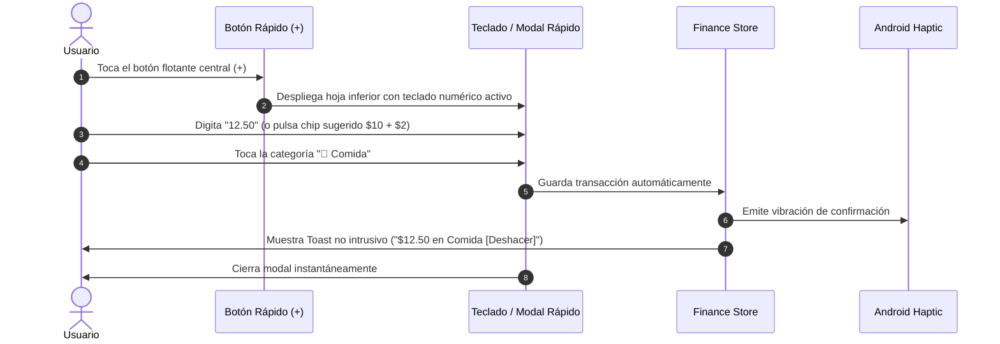
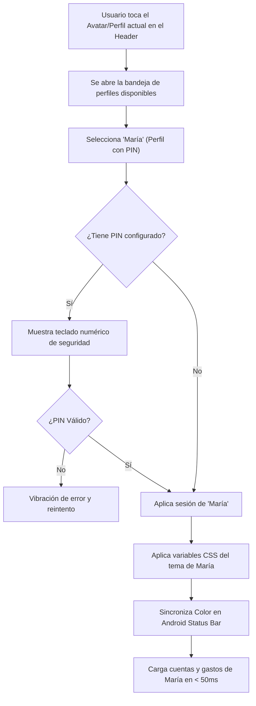

# 05. Especificación UI/UX y Flujos de Experiencia

## 1. Filosofía de Diseño: Velocidad Extrema y Cero Fricción

La interfaz de **Koin** está pensada para responder a las frustraciones habituales de las apps financieras tradicionales. Su diseño se rige por:
- **Operabilidad a una sola mano**: Los controles clave, teclado numérico y botones de guardado se sitúan en la mitad inferior de la pantalla.
- **Micro-interacciones táctiles (Haptics)**: Respuesta física sutil al pulsar números o confirmar registros en Android.
- **Perfiles visualmente inconfundibles**: Cambiar de perfil no es solo cambiar un nombre, sino transformar la paleta cromática completa para evitar equivocaciones de contexto.

---

## 2. Flujo Crítico 1: Registro Ultrarrápido (< 3 Segundos)

El objetivo es permitir registrar un gasto habitual en **2 toques** sin pasos intermedios innecesarios.



### Wireframe: Modal de Registro Rápido
```
┌──────────────────────────────────────────────┐
│  [Gasto (Activo)]    [Ingreso]   [Transfer]  │
├──────────────────────────────────────────────┤
│                                              │
│                  $ 12.50                     │
│          Cuenta: [Efectivo ▾]                │
│                                              │
├──────────────────────────────────────────────┤
│  Categorías Frecuentes (1 toque para guardar)│
│  ┌─────────┐ ┌─────────┐ ┌─────────┐         │
│  │ 🍔 Comida│ │ 🚗 Trans│ │ 🏠 Hogar│         │
│  └─────────┘ └─────────┘ └─────────┘         │
│  ┌─────────┐ ┌─────────┐ ┌─────────┐         │
│  │ 🍿 Ocio │ │ 💊 Salud│ │ ➕ Más  │         │
│  └─────────┘ └─────────┘ └─────────┘         │
├──────────────────────────────────────────────┤
│               TECLADO NUMÉRICO               │
│         [ 1 ]      [ 2 ]      [ 3 ]          │
│         [ 4 ]      [ 5 ]      [ 6 ]          │
│         [ 7 ]      [ 8 ]      [ 9 ]          │
│         [ . ]      [ 0 ]      [ ⌫ ]          │
├──────────────────────────────────────────────┤
│  [ + Agregar Nota / Foto ]      [ GUARDAR ]  │
└──────────────────────────────────────────────┘
```

---

## 3. Flujo Crítico 2: Conmutación de Perfiles

El usuario puede alternar entre perfiles en cualquier momento desde la barra superior o el menú lateral.



### Wireframe: Selector de Perfiles (Bottom Sheet)
```
┌──────────────────────────────────────────────┐
│             Perfiles Disponibles             │
├──────────────────────────────────────────────┤
│  (●) 🦁 Dylan (Personal)         [ACTIVO]    │
│      Tema: Esmeralda • 3 Cuentas             │
├──────────────────────────────────────────────┤
│  ( ) 💼 Dylan (Freelance)                    │
│      Tema: Amarillo Ámbar • 2 Cuentas        │
├──────────────────────────────────────────────┤
│  ( ) 🌸 María                   🔒 [Con PIN] │
│      Tema: Rosa Coral • 4 Cuentas            │
├──────────────────────────────────────────────┤
│  [ ➕ Crear Nuevo Perfil ]                   │
└──────────────────────────────────────────────┘
```

---

## 4. Flujo Crítico 3: Personalizador de Colores y Apariencia

Cada perfil cuenta con su propio menú de personalización dentro de **Ajustes > Apariencia**.

```
┌──────────────────────────────────────────────┐
│  ← Personalización de Perfil: Dylan          │
├──────────────────────────────────────────────┤
│  MODO BASE                                   │
│  [ Claro ]     [ Oscuro (✓) ]    [ AMOLED ]  │
├──────────────────────────────────────────────┤
│  PALETAS PRECONFIGURADAS                     │
│  [ 🌲 Esmeralda ]  [ 💎 Índigo ] [ 🍇 Púrpura ]│
│  [ 🌅 Coral ]     [ ⚡ Ámbar ]  [ 🌸 Pastel ] │
├──────────────────────────────────────────────┤
│  COLOR PERSONALIZADO (HEX)                   │
│  Muestra: [   #10B981   ]  [ 🎨 Elegir Color]│
├──────────────────────────────────────────────┤
│  VISTA PREVIA EN TIEMPO REAL                 │
│  ┌────────────────────────────────────────┐  │
│  │ Balance Total                          │  │
│  │ $ 4,250.00                             │  │
│  │ [ + Registrar Gasto ] (Botón dinámico) │  │
│  └────────────────────────────────────────┘  │
│  Texto: Contraste verificado (WCAG AAA)      │
├──────────────────────────────────────────────┤
│  [ GUARDAR CAMBIOS ]                         │
└──────────────────────────────────────────────┘
```

---

## 5. Arquitectura de Pantallas Principales

1. **Dashboard (Inicio)**:
   - Selector de Perfil y Saldo Neto Total consolidado.
   - Tarjetas de resumen del mes actual: Total Ingresos (verde), Total Gastos (rojo/naranja), Ahorro neto.
   - Carrusel deslizable de Cuentas (Efectivo, Tarjeta A, Tarjeta B) con saldo individual.
   - Últimos 5 movimientos con categorías coloreadas.
   - Botón central flotante de acción rápida (+).

2. **Transacciones (Historial)**:
   - Barra de búsqueda instantánea por nota o categoría.
   - Filtros rápidos por: Mes/Año, Tipo (Gasto/Ingreso), Cuenta específica y Categoría.
   - Agrupación por días: "Hoy", "Ayer", "Lunes 28 Octubre".

3. **Presupuestos y Metas**:
   - Barras de progreso de gasto mensual por categoría.
   - Indicador visual de alerta: Verde (<70%), Amarillo (70-99%), Rojo (>100% excedido).

4. **Estadísticas y Análisis**:
   - Gráfico de torta/dona interactivo con porcentaje por categoría.
   - Gráfico de barras comparativo de Ingresos vs Gastos de los últimos 6 meses.
