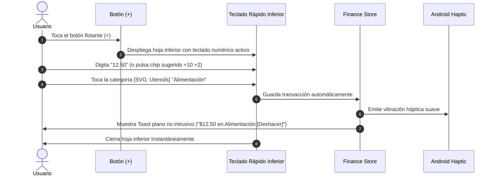

# 05. Especificación UI/UX y Sistema de Diseño (Koin)

## 1. Directivas Visuales y Filosofía de Diseño Minimalista

Para mantener una interfaz sobria, profesional y de carga ultrarrápida, el diseño de **Koin** se rige por tres directivas visuales estrictas:

```
┌────────────────────────────────────────────────────────────────────────┐
│                   DIRECTIVAS VISUALES OBLIGATORIAS                     │
├────────────────────────────────────────────────────────────────────────┤
│ 1. CERO EMOJIS (100% SVG ICONS):                                       │
│    Queda prohibido el uso de emojis en cualquier elemento de la UI     │
│    (avatares, categorías, cuentas, estados). Se utilizan               │
│    exclusivamente iconos SVG vectoriales limpios (Lucide Icons).       │
│                                                                        │
│ 2. CERO BADGES (ANTI-CLUTTER):                                         │
│    No se utilizan componentes <Badge> ni pastillas de color flotantes. │
│    Los estados y tipos se comunican mediante jerarquía tipográfica,   │
│    colores de texto discretos (muted-foreground) o puntos sutiles      │
│    (status dots de 4px).                                               │
│                                                                        │
│ 3. PROHIBICIÓN DE CARDS EN EXCESO (FLAT & DIVIDER DESIGN):             │
│    Se erradica el antipatrón de "cards dentro de cards" con bordes y  │
│    sombras pesadas. La interfaz utiliza líneas divisorias sutiles      │
│    (border-b border-border/40), espaciado en blanco y filas planas     │
│    (list rows), logrando un aspecto elegante y minimalista.            │
└────────────────────────────────────────────────────────────────────────┘
```

---

## 2. Flujo Crítico 1: Registro Ultrarrápido (< 3 Segundos)

El objetivo es permitir registrar un gasto habitual en **2 toques** sin pasos intermedios innecesarios.



### Wireframe: Entrada Rápida (Diseño Plano y Minimalista)
```
┌──────────────────────────────────────────────────────────────┐
│  Gasto (Activo)         Ingreso         Transferencia        │
├──────────────────────────────────────────────────────────────┤
│                                                              │
│                          $ 12.50                             │
│                  Cuenta: [SVG: Wallet] Efectivo              │
│                                                              │
├──────────────────────────────────────────────────────────────┤
│  Categorías frecuentes (1 toque para guardar)                │
│  [SVG: Utensils]     [SVG: Car]          [SVG: Home]         │
│  Alimentación        Transporte          Vivienda            │
│                                                              │
│  [SVG: Film]         [SVG: Activity]     [SVG: Plus]         │
│  Ocio                Salud               Más categorías      │
├──────────────────────────────────────────────────────────────┤
│                       TECLADO TÁCTIL                         │
│             1                 2                 3            │
│             4                 5                 6            │
│             7                 8                 9            │
│             .                 0                 ⌫            │
├──────────────────────────────────────────────────────────────┤
│  [SVG: FileText] Nota opcional                   [ GUARDAR ] │
└──────────────────────────────────────────────────────────────┘
```

---

## 3. Flujo Crítico 2: Conmutador de Perfiles (Diseño Plano de Filas)

En lugar de tarjetas abultadas, los perfiles se muestran en un listado plano con separadores sutiles:

```
┌──────────────────────────────────────────────────────────────┐
│  Perfiles                                     [SVG: Plus]    │
├──────────────────────────────────────────────────────────────┤
│  [SVG: User]  Dylan (Personal) • Activo                      │
│               Tema Esmeralda • USD                           │
├──────────────────────────────────────────────────────────────┤
│  [SVG: Briefcase] Dylan (Freelance)                          │
│                   Tema Ámbar • USD                           │
├──────────────────────────────────────────────────────────────┤
│  [SVG: Heart] María                           [SVG: Lock]    │
│               Tema Coral • COP • Requiere PIN                │
└──────────────────────────────────────────────────────────────┘
```
*(Nota: Sin badges ni tarjetas elevadas; solo filas limpias con divisores finos y estado tipográfico sobrio).*

---

## 4. Flujo Crítico 3: Personalizador de Colores y Apariencia

Cada perfil cuenta con su propio menú de personalización dentro de **Ajustes > Apariencia**.

```
┌──────────────────────────────────────────────────────────────┐
│  ← Apariencia del Perfil: Dylan                              │
├──────────────────────────────────────────────────────────────┤
│  MODO DE PANTALLA                                            │
│  Claro            Oscuro (Activo)            AMOLED (Negro)  │
├──────────────────────────────────────────────────────────────┤
│  PALETAS RECOMENDADAS                                        │
│  (●) Esmeralda   ( ) Índigo   ( ) Amatista                   │
│  ( ) Coral       ( ) Ámbar    ( ) Zafiro                     │
├──────────────────────────────────────────────────────────────┤
│  COLOR PERSONALIZADO                                         │
│  Hex: #10B981   [ Muestra visual SVG ]                       │
├──────────────────────────────────────────────────────────────┤
│  VISTA PREVIA                                                │
│  Balance Total: $ 4,250.00                                   │
│  Contraste verificado WCAG AA (Ratio 7.2:1)                  │
├──────────────────────────────────────────────────────────────┤
│  [ GUARDAR CAMBIOS ]                                         │
└──────────────────────────────────────────────────────────────┘
```

---

## 5. Arquitectura de Pantallas Principales (Diseño Plano y Minimalista)

1. **Dashboard (Inicio)**:
   - **Header plano**: Selector de perfil con icono SVG de usuario, nombre y botón de ajustes.
   - **Balance Consolidado**: Tipografía grande y limpia sin tarjeta envolvente (`$ 14,820.50`).
   - **Resumen del Mes (Filas Planas)**:
     - Ingresos: `+$ 4,200.00` (texto en verde sutil).
     - Gastos: `-$ 1,850.00` (texto en rojo/naranja sutil).
     - Ahorro Neto: `+$ 2,350.00`.
   - **Cuentas (Lista Horizontal Minimalista)**: Fila desplazable con icono SVG de cuenta y saldo, sin tarjetas flotantes con sombras pesadas.
   - **Últimos Movimientos**: Filas simples separadas por una línea sutil de 1px.
   - **Botón Flotante Central (+)**: Botón circular con icono SVG `Plus`.

2. **Transacciones (Historial)**:
   - Barra de búsqueda plana integrada en el encabezado.
   - Selector horizontal de filtros de texto (Todo / Gastos / Ingresos / Cuentas).
   - Filas limpias: Icono SVG a la izquierda, título de transacción y fecha en texto regular, monto a la derecha.

3. **Presupuestos**:
   - Filas por categoría con línea de progreso delgada (4px de alto) directamente debajo del nombre y monto restante en texto gris. Cero badges o tarjetas contenedoras.

4. **Estadísticas**:
   - Gráfico de dona vectorial sin marcos ni bordes innecesarios.
   - Lista desglosada con porcentaje en texto plano.
