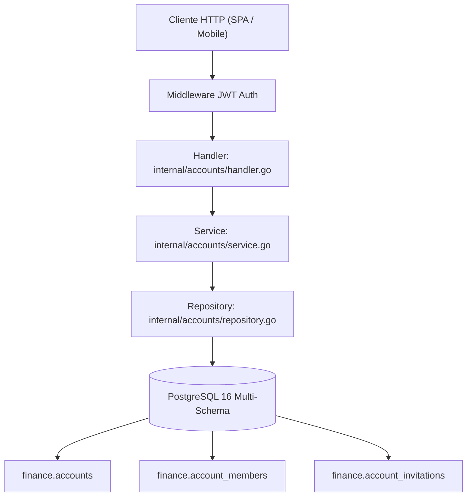

# Entregable Backend 03: Épica 4 — Cuentas Financieras y Colaboración Compartida (RBAC)

> **ID de Épica:** EPIC 4 — Cuentas financieras y colaboración compartida (RBAC)  
> **Historias de Usuario:** ACC-01, ACC-02, ACC-03, ACC-04  
> **Rama:** `feat/backend-epic-4-accounts-rbac`  
> **Responsable:** Dylan Gamero  
> **Fecha:** 04-11-2026  

---

## 1. Resumen Arquitectónico

Se implementó el backend completo en **Go (Chi)** para el núcleo de cuentas financieras privadas y colaborativas con aislamiento por perfiles y control de acceso basado en roles (RBAC):

- **Domain / Models (`apps/server/internal/models/models.go`)**: Modelos `Account`, `AccountMember`, `AccountInvitation`, `AccountWithRole` y DTOs de request/response.
- **Repository Layer (`apps/server/internal/accounts/repository.go`)**: Consultas SQL parametrizadas, balance dinámico derivado de transacciones, transacciones ACID para creación atómica y aceptación de invitaciones con bloqueo `FOR UPDATE`.
- **Application / Service Layer (`apps/server/internal/accounts/service.go`)**: Validaciones de dominio, generación de tokens criptográficos aleatorios de 32 bytes (64 caracteres hex) con expiración a 7 días, y jerarquía de permisos RBAC (`owner`, `editor`, `viewer`).
- **Presentation / HTTP Layer (`apps/server/internal/accounts/handler.go`)**: Resolución automática y segura de perfil activo (`X-Profile-ID` header, query param o perfil principal con validación de titularidad).

---

## 2. Modelos de Persistencia (PostgreSQL)

### Tabla `finance.accounts`
- `id` (UUID PK)
- `created_by_profile_id` (UUID FK `auth.profiles(id)`)
- `name` (VARCHAR 100)
- `type` (VARCHAR 20: `cash`, `bank`, `credit`, `savings`, `investment`)
- `currency` (VARCHAR 3: `USD`, `COP`, etc.)
- `initial_balance` (NUMERIC 14,2)
- `current_balance` (NUMERIC 14,2 - calculado en tiempo real con transacciones)
- `is_shared` (BOOLEAN)
- `color` (VARCHAR 20)
- `icon` (VARCHAR 50)
- `is_archived` (BOOLEAN)
- `created_at`, `updated_at`

### Tabla `finance.account_members`
- `id` (UUID PK)
- `account_id` (UUID FK `finance.accounts(id)`)
- `profile_id` (UUID FK `auth.profiles(id)`)
- `role` (VARCHAR 20: `owner`, `editor`, `viewer`)
- `status` (VARCHAR 20: `accepted`, `pending`)
- `created_at`
- Índice único `(account_id, profile_id)`

### Tabla `finance.account_invitations` (Nueva)
- `id` (UUID PK)
- `account_id` (UUID FK `finance.accounts(id)`)
- `inviter_profile_id` (UUID FK `auth.profiles(id)`)
- `role` (VARCHAR 20: `editor`, `viewer`)
- `token` (VARCHAR 128 UNIQUE)
- `expires_at` (TIMESTAMP WITH TIME ZONE - 7 días)
- `accepted_by_profile_id` (UUID FK `auth.profiles(id)`)
- `accepted_at` (TIMESTAMP WITH TIME ZONE)
- `created_at`

---

## 3. Endpoints REST Implementados

| Método | Ruta | Protección | Rol Mínimo | Descripción |
|---|---|:---:|:---:|---|
| `GET` | `/api/v1/accounts` | JWT + Profile | Miembro | Lista cuentas accesibles (propias o compartidas) con balance en tiempo real |
| `POST` | `/api/v1/accounts` | JWT + Profile | N/A | Crea nueva cuenta privada vinculada al perfil activo |
| `GET` | `/api/v1/accounts/{id}` | JWT + Profile | Miembro | Obtiene detalle de cuenta y rol del perfil |
| `PATCH` | `/api/v1/accounts/{id}` | JWT + Profile | `owner` | Modifica metadatos o archiva la cuenta |
| `DELETE` | `/api/v1/accounts/{id}` | JWT + Profile | `owner` | Elimina cuenta (valida integridad referencial) |
| `POST` | `/api/v1/accounts/{id}/invite` | JWT + Profile | `owner` | Genera token criptográfico y enlace de invitación con vigencia de 7 días |
| `GET` | `/api/v1/invitations/validate?token=...` | Pública | N/A | Valida token y retorna información previa para pantalla de aceptación |
| `POST` | `/api/v1/invitations/accept` | JWT | N/A | Vincula atómicamente la cuenta compartida al perfil seleccionado |
| `GET` | `/api/v1/accounts/{id}/members` | JWT + Profile | Miembro | Lista colaboradores con rol, nombre y avatar |
| `PATCH` | `/api/v1/accounts/{id}/members/{memberId}` | JWT + Profile | `owner` | Actualiza rol de un colaborador (`editor` / `viewer`) |
| `DELETE` | `/api/v1/accounts/{id}/members/{memberId}` | JWT + Profile | `owner` | Expulsa colaborador de la cuenta |
| `POST` | `/api/v1/accounts/{id}/leave` | JWT + Profile | Colaborador | Desvinculación voluntaria (el creador no puede abandonar) |

---

## 4. Contratos Compartidos (`packages/shared`)

- Interfaces: `AccountDTO`, `AccountMemberDTO`, `AccountInvitationDTO`.
- Esquemas Zod: `CreateAccountSchema`, `UpdateAccountSchema`, `CreateAccountInvitationSchema`, `AcceptAccountInvitationSchema`, `UpdateMemberRoleSchema`.
- Tipos de cuenta permitidos: `'cash' | 'bank' | 'credit' | 'savings' | 'investment'`.
- Tipos de roles: `'owner' | 'editor' | 'viewer'`.

---

## 5. Pruebas y Verificación

1. **Compilación y Linteo**:
   - `go vet ./...` (0 errores)
   - `CGO_ENABLED=0 go build -ldflags="-s -w" -o bin/api ./cmd/api` (binario estático listo para Alpine)
   - `pnpm check-types` en todo el monorepo (0 errores)

2. **Suite de Integración Automatizada (`test_accounts_backend.sh`)**:
   - Registro atómico de titular A y verificación de 2 cuentas iniciales sembradas (`owner`).
   - Creación de cuenta privada `Billetera Ahorros Emergencia` con saldo `$750.50`.
   - Modificación de nombre y color (`Fondo de Emergencia Familiar`, `#F59E0B`).
   - Generación de invitación criptográfica con rol `editor` y expiración a 7 días.
   - Validación pública de token sin autenticación (`isExpired: false`, `isAccepted: false`).
   - Registro de titular B ("Maria Invitada") y aceptación de invitación vinculada a su perfil.
   - Verificación de membresía compartida en tiempo real (`owner` + `editor`).
   - Modificación de rol a `viewer` por parte del propietario.
   - Desvinculación voluntaria de Maria ("Abandonar cuenta") confirmada.
   - Eliminación final de cuenta por parte del propietario.
