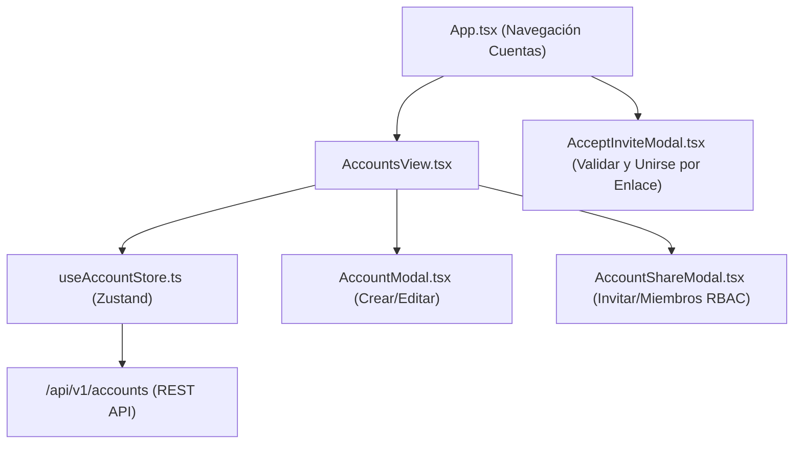

# Entregable Frontend 01: Épica 4 — Cuentas Financieras y Colaboración Compartida (RBAC)

> **ID de Épica:** EPIC 4 — Cuentas financieras y colaboración compartida (RBAC)  
> **Historias de Usuario:** ACC-01, ACC-02, ACC-03, ACC-04  
> **Rama:** `feat/frontend-epic-4-accounts-view`  
> **Responsable:** Dylan Gamero  
> **Fecha:** 04-11-2026  

---

## 1. Resumen de Implementación Frontend

Se implementó la experiencia completa de usuario en React 19 para la gestión de cuentas financieras privadas y colaborativas con roles RBAC (`owner`, `editor`, `viewer`), cumpliendo estrictamente las directivas de diseño (cero emojis, cero tarjetas flotantes, líneas divisorias de 1px y cero jerga técnica):

---

## 2. Componentes y Vistas Desarrollados

### 1. `AccountsView.tsx` ([`apps/web/src/components/accounts/AccountsView.tsx`](file:///home/dypok/Projects/Koin/apps/web/src/components/accounts/AccountsView.tsx))
- **Balance Consolidado**: Banner plano minimalista que suma en tiempo real los saldos de las cuentas en la divisa base del perfil activo.
- **Filtros por Tipo**: Pestañas de filtrado rápido ("Todas", "Efectivo", "Bancos", "Ahorros", "Tarjetas", "Inversiones", "Compartidas").
- **Listado Plano (Zero Cards)**: Contenedor con divisores sutiles de 1px (`divide-y divide-border/30`).
- **Filas de Cuenta**:
  - Avatar circular con color e icono SVG de Lucide (con contraste adaptativo).
  - Indicador de estado colaborativo: `Compartida · Propietario`, `Compartida · Editor` o `Compartida · Observador`.
  - Saldo en tipografía monoespaciada grande.
  - Acciones rápidas según el rol del usuario (Compartir, Editar, Eliminar o Abandonar).

### 2. `AccountModal.tsx` ([`apps/web/src/components/accounts/AccountModal.tsx`](file:///home/dypok/Projects/Koin/apps/web/src/components/accounts/AccountModal.tsx))
- Creación y edición de cuentas financieras.
- Selector de tipo de fondo: Efectivo, Banco, Tarjeta, Ahorros, Inversión.
- Selector de iconos vectoriales SVG de Lucide (`ALLOWED_ACCOUNT_ICONS`).
- Paleta de color distintivo con muestras circulares y selector libre hexadecimal.
- Saldo inicial configurable solo al crear; al editar, informa que el saldo se calcula por movimientos.

### 3. `AccountShareModal.tsx` ([`apps/web/src/components/accounts/AccountShareModal.tsx`](file:///home/dypok/Projects/Koin/apps/web/src/components/accounts/AccountShareModal.tsx))
- **Pestaña "Invitar por Enlace" (Propietario)**:
  - Selector de permisos: `Editor` ("Puede registrar transacciones") vs `Observador` ("Solo lectura").
  - Generación de enlace criptográfico firmado con expiración a 7 días.
  - Botón de copiado con 1 clic con confirmación visual interactiva.
- **Pestaña "Miembros Activos"**:
  - Lista de colaboradores con avatar y fecha de vinculación.
  - Conmutación dinámica de roles (`editor` $\leftrightarrow$ `viewer`).
  - Expulsión de miembros por parte del propietario.
  - Opción de "Abandonar Cuenta Compartida" para colaboradores.

### 4. `AcceptInviteModal.tsx` ([`apps/web/src/components/accounts/AcceptInviteModal.tsx`](file:///home/dypok/Projects/Koin/apps/web/src/components/accounts/AcceptInviteModal.tsx))
- Detecta automáticamente el parámetro `?token=...` en la URL al cargar la aplicación.
- Valida el token con el backend antes de mostrar la pantalla.
- Muestra anfitrión, nombre de cuenta, divisa y rol asignado.
- Permite al usuario seleccionar en cuál de sus perfiles personales desea vincular la cuenta.
- Al unirse, limpia la URL con `window.history.replaceState` y conmuta a la vista de cuentas.

### 5. `useAccountStore.ts` ([`apps/web/src/stores/accountStore.ts`](file:///home/dypok/Projects/Koin/apps/web/src/stores/accountStore.ts))
- Estado global Zustand con operaciones CRUD, invitaciones y gestión de miembros.
- Inyección transparente de cabecera `X-Profile-ID` para aislamiento contable por perfil.

---

## 3. Pruebas y Verificación

1. **Chequeo de Tipos**: `pnpm check-types` validado (0 errores).
2. **Build de Producción**: `pnpm --filter=@koin/web build` completado exitosamente en 3.37s.
3. **Contenedor Docker**: `koin-web` recreado y respondiendo 200 OK en `http://localhost:5173`.
